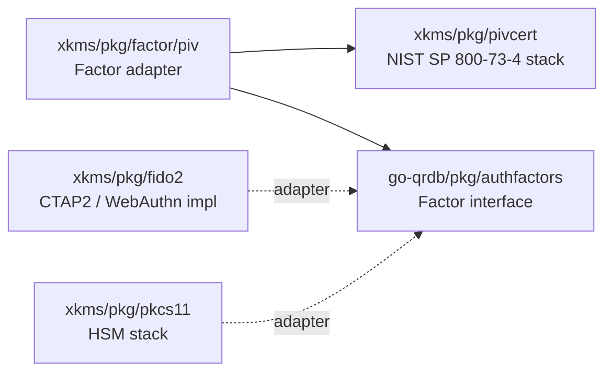

# Identity / authorization layering

xkms is a **consumer** of qrdb's identity layer, not a competing implementation.
This document describes the boundary between the two layers so additions stay
on the right side of it.

## The two layers

| Layer    | Owner   | Responsibilities                                                                                                                                                                          |
|----------|---------|-------------------------------------------------------------------------------------------------------------------------------------------------------------------------------------------|
| Identity | qrdb    | Tenants, users, role definitions, role memberships, and the whole permission registry — identity-domain (tenant/user CRUD, KV/MVCC, audit) *and* key-domain (keys, certs, seal, piv, ssh, ...). System-tenant rule for cross-tenancy. |
| Hardware | xkms    | Authentication adapters, hardware factors and seal strategies, the CA, and the single `auth.Authorizer` seam that asks qrdb for every authorization decision.                              |

xkms does not re-model identity. The `auth.Identity` type in `pkg/auth` is a
type alias for `qrdbauth.Identity` (`Subject`, `TenantID`, `Roles`, `Metadata`).
Authentication adapters (mTLS, JWT, OIDC) populate this shape directly.

## What xkms delegates to qrdb

go-qrdb is the single owner of barrier, bootstrap/first-boot, ceremony, and the
user/identity model. xkms consumes all of these through `go-qrdb/sdk/go` — it
carries **no local user model, cert-binding scheme, or barrier**:

| Capability | qrdb owns | xkms uses via |
|------------|-----------|---------------|
| User/identity model (`User`, RoleBindings, ABAC, factors) | `pkg/user` | `sdk/go/types_user.go` |
| mTLS cert-binding identifier | `ComputeSPKIThumbprint` (SHA-256 over SubjectPublicKeyInfo, base64url) | `sdk.ComputeSPKIThumbprint` |
| First-boot + admin-mTLS enrollment | `pkg/firstboot` | `sdk/go/types_firstboot.go` -- available, **not currently wired** (see below) |
| Barrier (none/passphrase/shamir; system + per-tenant) | `pkg/seal` | `sdk/go/types_seal*.go` |
| Ceremony (Shamir M-of-N, CSR claim) | `pkg/ceremony` | qrdb SDK |

xkms binds admin mTLS certs by qrdb's canonical SPKI thumbprint
(`pkg/auth/mtls.go`, `cmd/xkmsctl/admin.go`); the earlier divergent
`auth.ComputeCertFingerprint` binding identifier was removed. There is exactly
one cert-binding algorithm in the stack and it lives in qrdb.

## What xkms still OWNS

- **TrustedCA** (`pkg/ca`) — reaches qrdb through the `CeremonyCA` seam, which
  `initialize.CAAdapter` implements over `ca.TrustedCA`; the compile-time
  assertion is `var _ qrdbsdk.CeremonyCA = (*CAAdapter)(nil)`
  (`pkg/init/ca_adapter.go`). Admin enrollment is cert-based: CSR-sign (the CA
  signs an admin CSR) or generate-and-distribute (the CA emits a bundle). No
  invite tokens.

  qrdb also exposes `CertProvider` / `CertSigner` first-boot seams, and this
  page previously described `TrustedCA` as implementing them. It does not:
  `CertProvider`, `CertSigner`, `FirstBootInitialize` and `firstboot` appear
  nowhere in xkms production code. Enrollment runs through `CeremonyCA` and
  `pkg/init`'s `CeremonyService` instead. The unused seams are a genuine
  divergence between the stated layering and the wiring, not a naming variant —
  worth an explicit decision about which one xkms should stand behind.
- **Hardware factors** — PIV / FIDO2 / WebAuthn implementations registered into
  qrdb's `FactorRegistry` (see [Factor adapters](#factor-adapters-phase-1) below).
- **Hardware seal strategies** — TPM2 / PKCS#11 / cloud-KMS / Vault, registered
  into qrdb's `StrategyRegistry` as extensions of `passphrase`.

## SDK entry point

Downstream consumers reach qrdb through xkms's SDK so they only depend on a
single import:

```go
import xkms "github.com/jeremyhahn/go-xkms/sdk/go"

ac := xkms.Auth(qrdbClient)
ac.Users()       // qrdb UserClient
ac.Roles()       // qrdb RoleClient
ac.Permissions() // qrdb PermissionClient
ac.Factors()     // qrdb FactorClient (with xkms WebAuthn / PIV verifiers)
ac.Login()       // qrdb LoginClient
ac.Sessions()    // qrdb SessionClient
ac.RBAC()        // qrdb RBACClient (every authorization decision)
ac.VolumePools() // qrdb VolumePoolClient
```

The wrapper does not own state: the underlying qrdb client controls
connection lifecycle.

## Authorization is qrdb's, all of it

xkms once carried three key-domain packages — `pkg/keyrbac` (role → permission
registry), `pkg/keyauthz` (the middleware Authorizer), and `pkg/keypolicy`
(per-key Allow/Deny rules), renamed from `pkg/rbac`, `pkg/authz`, and
`pkg/policy`. **All three were deleted.** The key-domain vocabulary (`keys:sign`,
`certs:generate`, `seal:unseal`, ...) is part of qrdb's canonical permission
registry, so a second registry in xkms was duplication, not layering.

What remains in xkms is one seam, `auth.Authorizer` (`pkg/auth/authorize.go`):
it wraps a qrdb `RBACClient`, binds the identity's tenant as the request's
target tenant, and forwards `resource, action` to qrdb. The resource and action
identifiers the transports pass in are constants in `pkg/auth/permissions.go`
(plus the qrdb strings declared in `pkg/api/mcp/authz.go` for resources with no
constant). See [RBAC](../architecture/rbac.md) for the full vocabulary and the
per-transport gates.

Because the engine is qrdb's, RBAC requires `storage.backend: "qrdb"`. With any
other backend there is no identity plane, the authorizer is nil, and every
transport allows every request — `Config.ComplianceGaps` reports that
combination and the daemon refuses to start with it; there is no override.

## Identity flow on a request

```
incoming request
      |
      v
authenticator (mTLS/JWT/OIDC/...)  -> *qrdbauth.Identity (via type alias)
      |
      v
auth.WithIdentity(ctx, id)
      |
      v
transport gate (REST middleware / gRPC / QUIC / MCP)
      |
      v
auth.Authorizer.Authorize(ctx, id, resource, action)
      |
      v
qrdbClient.RBAC().Authorize(ctx, id, resource, action)   -- one engine,
                                                            identity- and
                                                            key-domain alike
```

## System-tenant rule (Phase 0)

The `pkg/auth` package exports `IsCrossTenant(*Identity) bool` which encodes
the cross-tenancy contract from qrdb Phase 0:

- Identity rooted in the reserved `system` tenant   -> cross-tenant scope.
- Empty `TenantID` (bootstrap)                       -> treated as system.
- Anything else                                      -> bound to its own tenant.

Middleware uses this helper to decide whether a request can see/modify
resources in tenants other than the identity's own. The check replaces the
deleted `Identity.IsCrossTenant()` method that lived on xkms's parallel
Identity struct before this refactor.

## What this layering is NOT

- It is **not** two parallel role systems. xkms defines no user records, role
  memberships, tenant model, or permission registry of its own.
- It is **not** an invitation to reintroduce a local authorization engine when
  a new resource needs a permission. Add the `resource:action` pair to qrdb's
  registry and reference it from the transport gate.
- It is **not** dependent on qrdb being remote. The same shape works when
  qrdb is embedded in-process via the embedded transport — which is the only
  supported RBAC deployment, since the identity plane exists only under
  `storage.backend: "qrdb"`.

## Factor adapters (Phase 1)

`go-qrdb/pkg/authfactors` defines the canonical `Factor` interface (Name,
Enroll, Challenge, Verify) and the `FactorRegistry` server option that
composes implementations into a qrdb server. **No hardware code lives in
qrdb** — every implementation of that interface that talks to a real
authenticator lives in xkms and is composed in at startup.



| Adapter | Source | Wraps | Status |
|---------|--------|-------|--------|
| PIV (`pkg/factor/piv`) | `pkg/factor/piv/factor.go:84` | xkms's PIV stack (`pkg/pivcert`, `xkms.PIVKeyGenerator`) | Shipped |
| FIDO2 | `pkg/fido2` (full RP impl) | CTAP2 / WebAuthn | Available through `pkg/webauthn` — see [WebAuthn RP](../webauthn/README.md) |
| PKCS#11 | `pkg/pkcs11` | HSM token sessions | Available; adapter wiring is composition-only |

The PIV adapter implements `authfactors.Factor` directly:

```go
// pkg/factor/piv/factor.go:84
type Factor struct {
    cfg Config
}

// Compile-time check
var _ authfactors.Factor = (*Factor)(nil)
```

`Factor` is cross-vendor: any `xkms.PIVKeyGenerator` (software, PKCS#11,
TPM2-backed) can be injected via `Config.Generator`. The adapter itself is
hardware-agnostic; the hardware-coupled logic remains in xkms.

The composing binary registers the adapter into qrdb's `FactorRegistry`:

```go
import (
    qrdbauthfactors "github.com/jeremyhahn/go-qrdb/pkg/authfactors"
    qrdbserver      "github.com/jeremyhahn/go-qrdb/pkg/server"
    xkmspivfactor   "github.com/jeremyhahn/go-xkms/pkg/factor/piv"
    xkms            "github.com/jeremyhahn/go-xkms/pkg/xkms"
)

registry := qrdbauthfactors.NewFactorRegistry()
_ = registry.Register(xkmspivfactor.New(xkmspivfactor.Config{
    Generator: xkms.NewSoftwarePIVKeyGenerator(),
}))

srv, err := qrdbserver.New(
    qrdbserver.WithFactorRegistry(registry),
    // ...
)
```

This is the same composition pattern used by the seal/strategy registry
and the PIN backend: qrdb defines the interface and the registry, xkms
supplies the hardware implementation, and quicbaas (or another composing
binary) wires them together.

## What still lives in `pkg/auth`

After the refactor, `pkg/auth` owns:

- The `Authenticator` interface (transport-aware: HTTP and gRPC).
- The mTLS, JWT, OIDC, NoOp, and Composite authenticator implementations
  (`mtls.go`, `jwt.go`, `oidc.go`, `noop.go`, `composite.go`), plus the
  PKCS#11 client TLS helper (`pkcs11_tls.go`). The removed "adaptive" mode
  (anonymous until the first user) is a validation error: first boot
  provisions the administrator and their mTLS credential at startup, so
  there is no pre-credential window to bridge.
- `QRDBUserStore` (`qrdb_userstore.go`), which resolves users from the qrdb
  identity plane by certificate SPKI thumbprint for the mTLS authenticator.
- The `Authorizer` seam (`authorize.go`) and the resource / action identifiers
  (`permissions.go`).
- The `Identity` type alias and the `WithIdentity` / `GetIdentity` /
  `WithTenantBarrier` / `GetTenantBarrier` context helpers.
- The `IsCrossTenant` and `FirstRole` helpers.

The deleted pieces — the standalone `Identity` struct, `HasPermission`,
`IsCrossTenant` / `HasRole` methods (replaced by qrdb's equivalents and the
package-level helpers), `pkg/user/UserRBACAdapter`, and the `pkg/auth/policy`
MFA step-up engine — were domain-IAM duplication and now live in qrdb.

## See also

- `docs/auth/bootstrap.md` — bootstrap-time auth flow.
- `docs/architecture/rbac.md` — permission vocabulary and transport gates.
- `pkg/auth/authorize.go` — the Authorizer that delegates to qrdb.
- `pkg/auth/auth.go` — Identity alias and helpers.
- qrdb's `docs/auth/layering.md` — the same boundary documented from
  qrdb's side.
