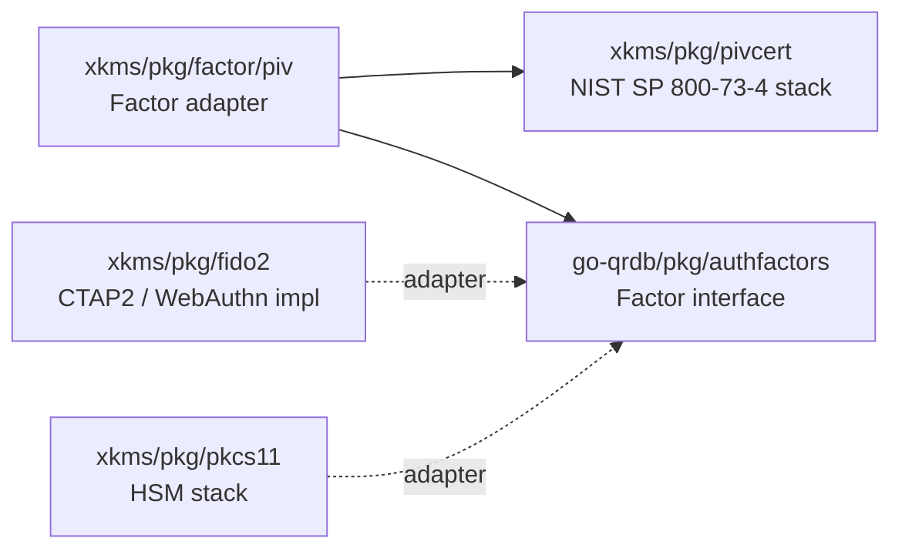

# Identity / authorization layering

xkms is a **consumer** of qrdb's identity layer, not a competing implementation.
This document describes the boundary between the two layers so additions stay
on the right side of it.

## The two layers

| Layer    | Owner   | Responsibilities                                                                                                                                                |
|----------|---------|-----------------------------------------------------------------------------------------------------------------------------------------------------------------|
| Identity | qrdb    | Tenants, users, role definitions, role memberships, identity-domain permissions (tenant CRUD, user CRUD, KV/MVCC, audit). System-tenant rule for cross-tenancy. |
| Key      | xkms    | Authorization for cryptographic / KMS operations: keys, certificates, secrets, barriers, audit-of-key-ops, backend management.                                  |

xkms does not re-model identity. The `auth.Identity` type in `pkg/auth` is a
type alias for `qrdbauth.Identity` (`Subject`, `TenantID`, `Roles`, `Metadata`).
Authentication adapters (mTLS, JWT, OIDC) populate this shape directly.

## What xkms delegates to qrdb

go-qrdb is the single owner of barrier, bootstrap/first-boot, ceremony, and the
user/identity model. xkms consumes all of these through `go-qrdb/sdk/go` — it
carries **no local user model, cert-binding scheme, or barrier**:

| Capability | qrdb owns | xkms uses via |
|------------|-----------|---------------|
| User/identity model (`User`, RoleBindings, ABAC, factors) | `pkg/user` | `sdk/go/types_user.go` |
| mTLS cert-binding identifier | `ComputeSPKIThumbprint` (SHA-256 over SubjectPublicKeyInfo, base64url) | `sdk.ComputeSPKIThumbprint` |
| First-boot + admin-mTLS enrollment | `pkg/firstboot` | `sdk/go/types_firstboot.go` |
| Barrier (none/passphrase/shamir; system + per-tenant) | `pkg/seal` | `sdk/go/types_seal*.go` |
| Ceremony (Shamir M-of-N, CSR claim) | `pkg/ceremony` | qrdb SDK |

xkms binds admin mTLS certs by qrdb's canonical SPKI thumbprint
(`pkg/auth/mtls.go`, `cmd/xkmsctl/admin.go`); the earlier divergent
`auth.ComputeCertFingerprint` binding identifier was removed. There is exactly
one cert-binding algorithm in the stack and it lives in qrdb.

## What xkms still OWNS

- **TrustedCA** (`pkg/ca`) — implements qrdb's `CertProvider` / `CertSigner`
  (admin-mTLS Path A and Path B) and `CeremonyCA` seams. Admin enrollment is
  cert-based: CSR-sign (the CA signs an admin CSR) or generate-and-distribute
  (the CA emits a bundle). No invite tokens.
- **Hardware factors** — PIV / FIDO2 / WebAuthn implementations registered into
  qrdb's `FactorRegistry` (see [Factor adapters](#factor-adapters-phase-1) below).
- **Hardware seal strategies** — TPM2 / PKCS#11 / cloud-KMS / Vault, registered
  into qrdb's `StrategyRegistry` as extensions of `passphrase`.

## SDK entry point

Downstream consumers reach qrdb through xkms's SDK so they only depend on a
single import:

```go
import xkms "github.com/jeremyhahn/go-xkms/sdk/go"

ac := xkms.Auth(qrdbClient)
ac.Users()       // qrdb UserClient
ac.Roles()       // qrdb RoleClient
ac.Permissions() // qrdb PermissionClient
ac.Factors()     // qrdb FactorClient (with xkms WebAuthn / PIV verifiers)
ac.Login()       // qrdb LoginClient
ac.Sessions()    // qrdb SessionClient
ac.RBAC()        // qrdb RBACClient (identity-domain authorization)
ac.VolumePools() // qrdb VolumePoolClient
```

The wrapper does not own state: the underlying qrdb client controls
connection lifecycle.

## xkms's three key-domain packages

Authorization for key-domain resources lives in xkms because the permission
vocabulary (sign, encrypt, issue-cert, ...) is xkms-specific and would
contaminate qrdb's identity registry if pushed upstream.

- **`pkg/keypolicy`** — Allow/Deny rules for individual key operations
  (Sign, Encrypt) with wildcard resource matching. Used by per-key policies
  attached to specific `KeyAttributes`.

- **`pkg/keyrbac`** — The role → key-permission registry. The `Admin` role
  grants `{keys:*, certificates:*, secrets:*, barrier:*, audit:*, backends:*,
  pin:*, credentials:*, passwords:*}`; `Operator` grants a narrower set;
  `Auditor` grants `{audit:read}`; etc. These permissions are xkms-domain;
  qrdb does not know about them.

- **`pkg/keyauthz`** — The Authorizer interface used by middleware. Adapts
  `keyrbac` into the request-shaped `AuthorizationRequest` /
  `AuthorizationDecision` model.

These packages were renamed from `pkg/policy`, `pkg/rbac`, and `pkg/authz` to
make their key-domain scope unambiguous in the source tree.

## Identity flow on a request

```
incoming request
      |
      v
authenticator (mTLS/JWT/OIDC/...)  -> *qrdbauth.Identity (via type alias)
      |
      v
auth.WithIdentity(ctx, id)
      |
      v
middleware:
  - identity-domain op (e.g. tenant:list:cross)
        -> qrdb.RBAC().Authorize(id, resource, action)
  - key-domain op (e.g. keys:read, secrets:create)
        -> identity.Roles -> keyrbac.CheckPermission(roles, perm)
```

## System-tenant rule (Phase 0)

The `pkg/auth` package exports `IsCrossTenant(*Identity) bool` which encodes
the cross-tenancy contract from qrdb Phase 0:

- Identity rooted in the reserved `system` tenant   -> cross-tenant scope.
- Empty `TenantID` (bootstrap)                       -> treated as system.
- Anything else                                      -> bound to its own tenant.

Middleware uses this helper to decide whether a request can see/modify
resources in tenants other than the identity's own. The check replaces the
deleted `Identity.IsCrossTenant()` method that lived on xkms's parallel
Identity struct before this refactor.

## What this layering is NOT

- It is **not** two parallel role systems. xkms does not define its own
  user records, role memberships, or tenant model.
- It is **not** an opportunity to push key-domain permissions back into
  qrdb's permission registry. Doing so would couple qrdb's release cadence
  to xkms's permission vocabulary.
- It is **not** dependent on qrdb being remote. The same shape works when
  qrdb is embedded in-process via the embedded transport.

## Factor adapters (Phase 1)

`go-qrdb/pkg/authfactors` defines the canonical `Factor` interface (Name,
Enroll, Challenge, Verify) and the `FactorRegistry` server option that
composes implementations into a qrdb server. **No hardware code lives in
qrdb** — every implementation of that interface that talks to a real
authenticator lives in xkms and is composed in at startup.



| Adapter | Source | Wraps | Status |
|---------|--------|-------|--------|
| PIV (`pkg/factor/piv`) | `pkg/factor/piv/factor.go:84` | xkms's PIV stack (`pkg/pivcert`, `xkms.PIVKeyGenerator`) | Shipped |
| FIDO2 | `pkg/fido2` (full RP impl) | CTAP2 / WebAuthn | Available through `pkg/webauthn` — see [WebAuthn RP](../webauthn/README.md) |
| PKCS#11 | `pkg/pkcs11` | HSM token sessions | Available; adapter wiring is composition-only |

The PIV adapter implements `authfactors.Factor` directly:

```go
// pkg/factor/piv/factor.go:84
type Factor struct {
    cfg Config
}

// Compile-time check
var _ authfactors.Factor = (*Factor)(nil)
```

`Factor` is cross-vendor: any `xkms.PIVKeyGenerator` (software, PKCS#11,
TPM2-backed) can be injected via `Config.Generator`. The adapter itself is
hardware-agnostic; the hardware-coupled logic remains in xkms.

The composing binary registers the adapter into qrdb's `FactorRegistry`:

```go
import (
    qrdbauthfactors "github.com/jeremyhahn/go-qrdb/pkg/authfactors"
    qrdbserver      "github.com/jeremyhahn/go-qrdb/pkg/server"
    xkmspivfactor   "github.com/jeremyhahn/go-xkms/pkg/factor/piv"
    xkms            "github.com/jeremyhahn/go-xkms/pkg/xkms"
)

registry := qrdbauthfactors.NewFactorRegistry()
_ = registry.Register(xkmspivfactor.New(xkmspivfactor.Config{
    Generator: xkms.NewSoftwarePIVKeyGenerator(),
}))

srv, err := qrdbserver.New(
    qrdbserver.WithFactorRegistry(registry),
    // ...
)
```

This is the same composition pattern used by the seal/strategy registry
and the PIN backend: qrdb defines the interface and the registry, xkms
supplies the hardware implementation, and quicbaas (or another composing
binary) wires them together.

## What still lives in `pkg/auth`

After the refactor, `pkg/auth` owns:

- The `Authenticator` interface (transport-aware: HTTP and gRPC).
- The mTLS, JWT, OIDC, NoOp, Composite, and Adaptive authenticator
  implementations.
- The MFA policy gating in `pkg/auth/policy` (distinct from `pkg/keypolicy`).
- The `Identity` type alias and the `WithIdentity` / `GetIdentity` /
  `WithTenantBarrier` / `GetTenantBarrier` context helpers.
- The `IsCrossTenant` and `FirstRole` helpers.

The deleted pieces — the standalone `Identity` struct, `HasPermission`,
`IsCrossTenant` / `HasRole` methods (replaced by qrdb's equivalents and the
package-level helpers), and `pkg/user/UserRBACAdapter` — were domain-IAM
duplication and have moved to qrdb (membership) or `pkg/keyrbac` (permission
decisions).

## See also

- `docs/auth/bootstrap.md` — bootstrap-time auth flow.
- `docs/auth/mfa-policy.md` — MFA gating policy.
- `pkg/keyrbac/rbac.go` — the role -> permission registry source of truth.
- `pkg/auth/auth.go` — Identity alias and helpers.
- qrdb's `docs/auth/layering.md` — the same boundary documented from
  qrdb's side.
