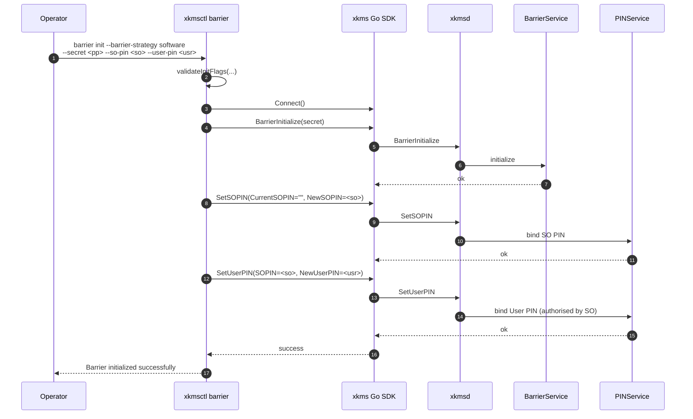
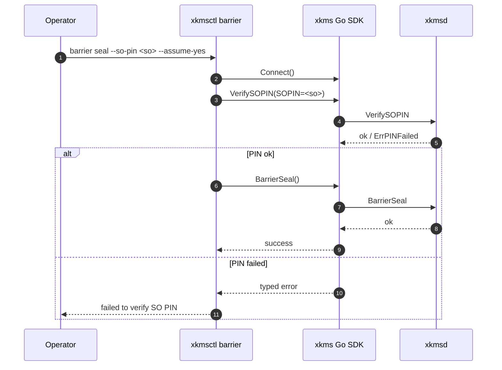

<!--
Copyright (c) 2025 Jeremy Hahn
Copyright (c) 2025 Automate The Things, LLC
SPDX-License-Identifier: AGPL-3.0-or-later
-->

# `xkmsctl barrier` — Canonical Barrier CLI Surface

`xkmsctl barrier` exposes the **canonical 9-verb barrier tree** shared
byte-for-byte by `qrdb barrier`, `quicbaas barrier`, and
`platformctl barrier`. The single source of truth for the verb tree
and validation rules is the qrdb implementation
([`go-qrdb/docs/cli/barrier.md`](../../../go-qrdb/docs/cli/barrier.md));
this page documents the **xkms-specific specifics** — chiefly the
PIN-dispatch pattern xkms uses to preserve UX parity without
modifying its wire types.

Implementation: [`cmd/xkmsctl/barrier.go`](../../cmd/xkmsctl/barrier.go).

---

## 1. The locked 9-verb tree

```
xkmsctl barrier status
xkmsctl barrier init           --barrier-strategy <none|software|shamir>
                               [--secret <pp>]               (required for software/shamir; rejected for none)
                               [--so-pin <pin>]              (optional; rejected when --barrier-strategy=none)
                               [--user-pin <pin>]            (optional; requires --so-pin)
xkmsctl barrier init-shamir    --secret <pp>
                               --threshold N
                               --total M
                               [--so-pin <pin>]
                               [--user-pin <pin>]            (requires --so-pin)
xkmsctl barrier unseal         --secret <pp>                 (software / single-secret only)
xkmsctl barrier unseal-shares  --share <s1> [--share <s2> ...]
                               | --shares-file <path>        ('-' = stdin)
xkmsctl barrier seal           [--so-pin <pin>]
                               [-y | --assume-yes]
xkmsctl barrier rekey          --secret <new-pp>
                               [--so-pin <pin>]              (NO --user-pin on rekey)
                               --threshold N --total M       (REQUIRED on xkms; see §3.2)
xkmsctl barrier recovery generate
                               --threshold N --total M
                               [--so-pin <pin>]
xkmsctl barrier recovery recover
                               --share <s1> [--share <s2> ...]
```

### Root persistent flag

| Flag | Default | Allowed values |
|------|---------|----------------|
| `--transport` | `unix` | `rest`, `grpc`, `quic`, `mcp`, `unix`, `embedded` |

`unix` is the default across all four CLIs. The constant is defined as
[`DefaultTransport`](../../cmd/xkmsctl/config.go) in xkmsctl's config
package.

---

## 2. `--secret` vs. `--so-pin` / `--user-pin`

| Flag | Concern | Backend |
|------|---------|---------|
| `--secret` | Strategy wrapping passphrase. Software derives the wrapping key via Argon2id; Shamir uses it as the strategy seal; None ignores it. | `pkg/seal` strategies (`StrategyRegistry`) |
| `--so-pin`, `--user-pin` | Two-PIN compliance-gating material (FIPS 140-3 / PCI-DSS v4). | xkms `pkg/pin` `PINBackend` |

The two are independent. `--secret` is **not** a PIN and never was;
the canonical naming has always been correct.

---

## 3. xkms-specific specifics

### 3.1 Option B: PIN dispatch through separate RPCs

xkms's wire-level `BarrierService` request types intentionally do
**not** carry SO/User PIN fields. To deliver the canonical CLI UX
without touching the wire, `xkmsctl barrier` dispatches PIN material
through xkms's existing pin RPCs **before or after** the barrier RPC,
as appropriate.



The dispatcher lives in
[`applyInitialPINPair`](../../cmd/xkmsctl/barrier.go) (called from
`runBarrierInitCmd` and `runBarrierInitShamirCmd`).

For destructive verbs that only need to **verify** an existing SO
PIN — `seal`, `rekey`, `recovery generate` — xkmsctl pre-flights
[`verifySOPINIfSupplied`](../../cmd/xkmsctl/barrier.go) before
issuing the barrier RPC:



### 3.2 `barrier rekey` requires `--threshold` and `--total`

xkms's wire-level `BarrierRekey` request currently carries only
Shamir share regeneration parameters; it has no first-class
"passphrase rotation only" code path. To keep the four-CLI flag
surface lock-step, xkmsctl accepts `--secret` at the flag level but
emits `XKMSPassphraseRekeyUnsupportedError` if it is supplied without
`--threshold` and `--total`:

```bash
# Accepted — Shamir share regeneration with the new wrapping material
xkmsctl barrier rekey --secret '<new-pp>' --threshold 3 --total 5

# Rejected — secret-only rekey not supported on xkms's wire
xkmsctl barrier rekey --secret '<new-pp>'
```

`qrdb` and `quicbaas` accept either form.

### 3.3 Strategy + PIN matrix on `barrier init`

The CLI rejects PINs when `--barrier-strategy=none` because there is
nothing for them to gate; the same rule applies in every CLI.
Validation is a pure function (`validateInitFlags`), tested by
[`canonical_surface_test.go`](../../cmd/xkmsctl/canonical_surface_test.go).

| `--barrier-strategy` | `--secret` | `--so-pin` | `--user-pin` | Result |
|---|---|---|---|---|
| `none` | empty | empty | empty | OK |
| `none` | non-empty | — | — | `BarrierSecretNotAllowedError` |
| `none` | — | non-empty | — | `PINsNotAllowedError` |
| `none` | — | — | non-empty | `PINsNotAllowedError` |
| `software` | empty | — | — | `BarrierSecretRequiredError` |
| `software` | non-empty | empty | empty | OK |
| `software` | non-empty | set | empty | `PINPairError` |
| `software` | non-empty | empty | set | `PINPairError` |
| `software` | non-empty | set | set | OK |
| `shamir` | — | — | — | `BarrierShamirOnInitError` (use `init-shamir`) |

---

## 4. Cross-references

* Canonical spec: [`08-bootstrap-auth-architecture.md §6`](https://github.com/automatethethings/software/blob/main/docs/08-bootstrap-auth-architecture.md#6-cli-surface-convergence)
* Canonical verb-tree narrative: [`go-qrdb/docs/cli/barrier.md`](../../../go-qrdb/docs/cli/barrier.md)
* xkms PIN backend: [`docs/pin/README.md`](../pin/README.md)
* xkms seal strategies: [`docs/seal/README.md`](../seal/README.md)
* Sibling CLI docs:
  [`qrdb barrier`](../../../go-qrdb/docs/cli/barrier.md) ·
  [`quicbaas barrier`](../../../go-quicbaas/docs/cli/barrier.md) ·
  [`platformctl barrier`](../../../go-trusted-platform/docs/cli/barrier.md)
