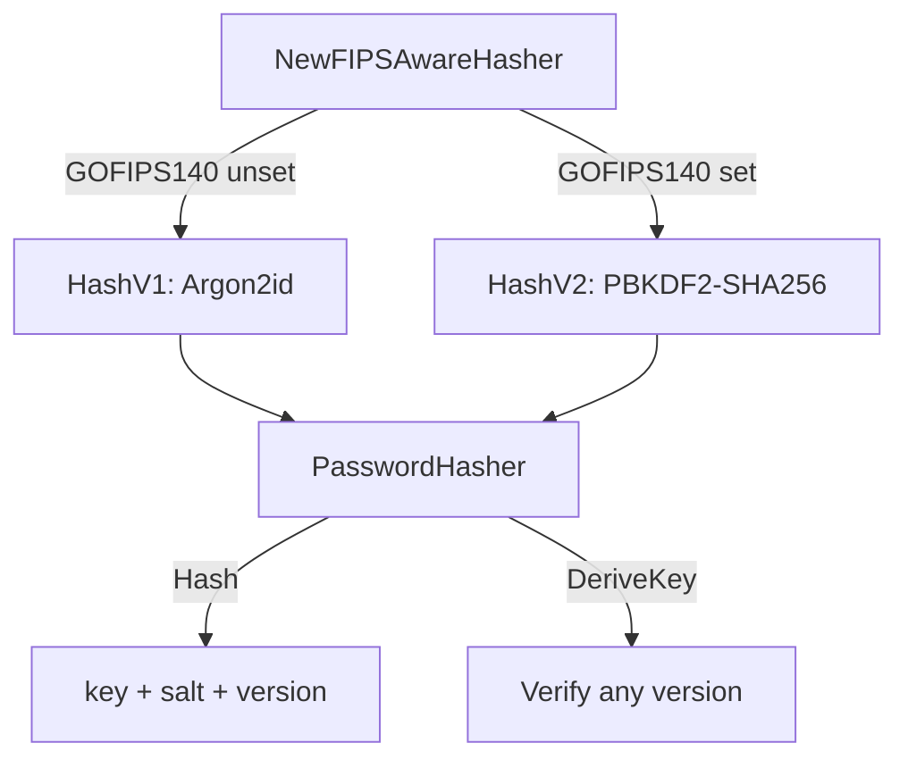

# FIPS 140 Strategy

## Overview

go-xkms provides transparent FIPS 140 mode detection and algorithm selection. When the `GOFIPS140` environment variable is set, cryptographic algorithm defaults automatically switch to FIPS-approved alternatives. No code changes are required.

**Packages**:
- `github.com/jeremyhahn/go-xkms/pkg/crypto/fips` -- mode detection and KDF selection
- `github.com/jeremyhahn/go-xkms/pkg/crypto/kdf` -- `PasswordHasher` with versioned algorithms

## FIPS Mode Detection

```go
import "github.com/jeremyhahn/go-xkms/pkg/crypto/fips"

if fips.Enabled() {
    // GOFIPS140 is set to a non-empty value
}
```

Detection checks `os.Getenv("GOFIPS140")`. The toolchain accepts `off`, `latest`,
`inprocess`, `certified` and `v1.Y.Z`; only `off` (and unset) means disabled.

```bash
# Enable FIPS mode
export GOFIPS140=latest

# Disable (default)
unset GOFIPS140
```

`fips.Enabled()` is the *runtime* signal: the `GOFIPS140` environment variable of
this process. `fips.Compiled()` is the *module-state* signal —
`crypto/fips140.Enabled()`, true when the Go Cryptographic Module is in force
here. A FIPS build turns it on by default, and it is the signal that survives
into a FIPS-compiled shared library whose loading process carries no
`GOFIPS140`. Controls that must hold wherever the FIPS crypto is actually
running test `Compiled() || Enabled()`.

Neither one is build provenance. `GODEBUG=fips140` selects the module state in
**either** direction, so `Compiled()` goes false on a `GOFIPS140`-built binary
run under `GODEBUG=fips140=off`, and true on a stock binary run under
`GODEBUG=fips140=on` (#219).

## Build provenance

`fips.BuildSetting()` returns the `GOFIPS140` value the toolchain stamped into
the binary at link time — the `build GOFIPS140=<value>` line of
`go version -m` — and `fips.Built()` reports whether that value enables the
module. The stamp is fixed at link time, no environment variable alters it, and
it survives into a c-shared library a foreign process `dlopen()`s.

| Predicate | Answers | Moves with `GODEBUG=fips140` |
|-----------|---------|------------------------------|
| `Enabled()` | is `GOFIPS140` set in this process's environment | no |
| `Compiled()` | is the FIPS module in force in this process | **yes** |
| `Built()` | was this artifact compiled with `GOFIPS140` | no |

The toolchain records the setting only when it enables the module, so a build
with no `GOFIPS140` and one with an explicit `GOFIPS140=off` both read back as
`""`. `BuildSetting()` reports the selector the build ran with (`latest`,
`inprocess`, `certified`, `v1.Y.Z`), so a compliance manifest can name the
module version rather than only the fact of a FIPS build.

Anything that **labels an artifact** — a token model string, a library banner, a
compliance manifest — uses `Built()`. The PKCS#11 module's
`CK_INFO.libraryDescription` and `CK_TOKEN_INFO.model` derive from it, so the
shipped `libxkms_pkcs11_fips.so` identifies itself as FIPS even when the loading
process sets `GODEBUG=fips140=off`, and a stock build never claims to be one
under `GODEBUG=fips140=on`.

**Algorithm policy uses all three signals.** `AlgorithmPermitted` follows
`Built() || Compiled() || Enabled()`. A binary built with an enabling
`GOFIPS140` keeps enforcing the approved-only allowlist even when an operator
sets `GODEBUG=fips140=off` at runtime — provenance is fixed at link time and
the environment cannot revoke it — so a validated artifact cannot be talked
out of its own posture that way (owner ruling on #219). A binary never built
with `GOFIPS140` is unaffected: the allowlist still stops applying, exactly
as in a non-FIPS build, whenever neither `Compiled()` nor `Enabled()` is
active either.

## Approved algorithm set

`fips.ApprovedAlgorithm` is the repository's answer to "may a FIPS deployment use
this key algorithm", and `fips.AlgorithmPermitted` pairs it with mode detection.
The key-ID allowlists in `pkg/validation` and `pkg/xkms` filter through it, so in
FIPS mode a key ID naming a non-approved algorithm is rejected rather than
accepted and later failing somewhere less obvious.

| Approved | Basis |
|----------|-------|
| RSA, ECDSA P-256/384/521 | FIPS 186-5 |
| Ed25519, Ed448 | FIPS 186-5 |
| AES-128/192/256-GCM | FIPS 197 + SP 800-38D |
| ML-DSA-44/65/87 | FIPS 204 |
| ML-KEM-512/768/1024 | FIPS 203 |
| HMAC-SHA-256/384/512 | FIPS 198-1 |

### Absent from FIPS mode

These stay fully present and fully tested in a normal build. Only a FIPS-mode run
refuses them:

| Withheld | Why | Approved substitute |
|----------|-----|---------------------|
| `chacha20-poly1305`, `xchacha20-poly1305` | Not an approved AEAD | AES-256-GCM |
| `x25519`, `x448` | SP 800-56A Rev. 3 approves only the NIST curves and finite field groups for key agreement. `crypto/ecdh` under `GODEBUG=fips140=only` refuses X25519 outright. | ECDH P-256/384/521 |
| `frost-*` (all RFC 9591 ciphersuites, including `frost-p256`) | Threshold Schnorr is not an approved signature scheme; the approval is of the scheme, not the curve underneath it. | None — no approved threshold signature scheme exists |

The allowlist in `pkg/crypto/fips` is an allowlist rather than a denylist so the
control fails closed: an algorithm added to a caller's own list is refused in FIPS
mode until it is added to the approved set deliberately.

**Algorithm approval is not implementation validation.** ML-DSA and Ed448 are
reached through `github.com/cloudflare/circl`, so admitting them asserts an
approved *algorithm*, not a validated *module*. A deployment that must claim a
validated implementation has a narrower list than this one.

## KDF Selection

The `fips` package provides default KDF selectors that the rest of the system uses to pick algorithms:

```go
kdf := fips.DefaultKDF()      // "argon2id" or "pbkdf2"
luksKDF := fips.DefaultLUKSKDF() // "argon2id" or "pbkdf2"
```

| Mode | `DefaultKDF()` | `DefaultLUKSKDF()` |
|------|----------------|--------------------|
| Standard | `argon2id` | `argon2id` |
| FIPS | `pbkdf2` | `pbkdf2` |

Argon2id is the default because it provides superior resistance to GPU/ASIC attacks. PBKDF2 is selected in FIPS mode because it is the only password-based KDF approved under NIST SP 800-132.

## PasswordHasher

`PasswordHasher` in `pkg/crypto/kdf` provides FIPS-aware password hashing with versioned algorithms. Both adapters (Argon2id and PBKDF2) are always initialized, allowing verification of hashes produced by any version regardless of the current mode.



### Versions

| Version | Algorithm | Parameters |
|---------|-----------|------------|
| `HashV1` | Argon2id | time=3, memory=64 MiB, threads=4, keyLen=32 |
| `HashV2` | PBKDF2-SHA256 | iterations=600,000, keyLen=32 |

Salt length is 32 bytes for both versions (minimum accepted: 16 bytes).

### Usage

```go
import "github.com/jeremyhahn/go-xkms/pkg/crypto/kdf"

// Auto-selects version based on FIPS mode.
hasher := kdf.NewFIPSAwareHasher()

// Hash a password (generates random salt).
key, salt, version, err := hasher.Hash([]byte("my-password"))

// Store key, salt, and version alongside the account record.

// Later: verify by re-deriving with the stored salt and version.
derived, err := hasher.DeriveKey([]byte("my-password"), salt, version)
// Compare derived == key using constant-time comparison.
```

### Explicit Version Selection

```go
// Force Argon2id regardless of FIPS mode.
hasher, err := kdf.NewPasswordHasher(kdf.HashV1)

// Force PBKDF2 regardless of FIPS mode.
hasher, err := kdf.NewPasswordHasher(kdf.HashV2)

// Check current mode.
if hasher.IsFIPS() {
    // Using PBKDF2
}
```

### Cross-Version Verification

A hasher created with any version can verify hashes from any other version, because both Argon2id and PBKDF2 adapters are always initialized internally:

```go
// Hash was created in standard mode (V1/Argon2id).
key, salt, version, _ := standardHasher.Hash(password)

// System later switches to FIPS mode (V2/PBKDF2).
fipsHasher := kdf.NewFIPSAwareHasher()

// Verification still works -- DeriveKey dispatches on the stored version.
derived, err := fipsHasher.DeriveKey(password, salt, version)
```

## Integration Points

The FIPS strategy is consumed by several subsystems:

| Subsystem | Usage |
|-----------|-------|
| Barrier seal/unseal | KDF for deriving data encryption keys |
| PlatformStore | Password hashing for stored credentials |
| User management | Account password hashing |
| LUKS passphrase derivation | KDF for disk encryption keys |
| Raw PKCS#1 v1.5 signatures | `Sign` / `Verify` with hash `NONE` on an in-process RSA key refuse with `types.ErrRawPKCS1v15Enforced` under `GODEBUG=fips140=only` (see [Hash selection](#hash-selection)) |
| AEAD auto-selection | Forces AES-256-GCM over ChaCha20-Poly1305 ([AEAD Auto-Selection](../configuration/aead-auto-selection.md)) |
| Key-ID validation | Filters `pkg/validation` and `pkg/xkms` algorithm allowlists to the approved set |
| PKCS#11 authenticated wrapping | Refuses `C_WrapKeyAuthenticated` / `C_UnwrapKeyAuthenticated` with `CKR_MECHANISM_INVALID` when the runtime withholds arbitrary-IV GCM (see [AEAD construction](#aead-construction)) |

## Error Handling

```go
var (
    ErrHasherInvalidVersion  // unsupported hash version
    ErrHasherInvalidPassword // empty password
    ErrHasherInvalidSalt     // salt is nil or shorter than 16 bytes
)
```

## Hash selection

Digest strength is enforced separately from `GOFIPS140`, and it is
purpose-scoped the way SP 800-131A Rev. 2 is:

- **Signing, certificates, TPM attestation** -- MD4, MD5, SHA-1, MD5+SHA1 and
  RIPEMD-160 are refused by default. `crypto.allow_weak_hashes` re-admits them
  outside FIPS mode, applied by `server.New` and warned about on every start;
  under `GOFIPS140` / `GODEBUG=fips140` the setting is ignored. See
  [Weak hash policy](../crypto/weak-hashes.md).
- **Certificate display thumbprints** -- `certstore.ToString` (exported through
  the SDK as `CertToString`) prints a **SHA-256** fingerprint and no SHA-1 one.
  `crypto/sha1.Sum` *panics* under `GODEBUG=fips140=only` rather than returning
  an error, so any FIPS-activated process that formatted a certificate for
  display used to die there. The line is removed rather than guarded: the
  question a guard must ask is "is SHA-1 fatal in this process", the
  `fips140=only` *activation* state, and no predicate answers it. `Compiled()`
  is module state, which `GODEBUG=fips140=off` turns false on a
  `GOFIPS140`-built binary, and `Built()` is provenance, which says nothing
  about how the process was started (#219). A guard would therefore fail open
  precisely for FIPS artifacts. `crypto/sha1` is no longer
  imported by the package. Consumers comparing against
  `openssl x509 -fingerprint` must pass `-sha256`.
- **Raw PKCS#1 v1.5 signatures (hash `NONE`)** -- `Sign` and `Verify` accept
  the hash name `NONE` to sign or check caller-built bytes verbatim, which is
  what PKCS#11's `CKM_RSA_PKCS` sends. Under `GODEBUG=fips140=only`,
  `crypto/rsa` admits a PKCS#1 v1.5 signature only under a digest it can
  classify as approved, and it *panics* on `crypto.Hash(0)` rather than
  returning an error. `types.CheckRawPKCS1v15` refuses first with
  `types.ErrRawPKCS1v15Enforced`; `pkg/xkms` wraps it in `ErrSigningFailed` /
  `ErrVerificationFailed`, and the `pkcs11test` mock backend returns it
  directly. The gate is `crypto/fips140.Enforced` -- the very variable
  `crypto/rsa` reads at that site, so it cannot disagree with the runtime --
  not `fips140.Enabled`, which is also true under `fips140=on`, where the raw
  form works and is left alone. Only in-process `*rsa.PrivateKey` /
  `*rsa.PublicKey` values are governed: a PKCS#11 or TPM signer builds its own
  `DigestInfo` and never reaches `crypto/rsa` (#486).
- **Key derivation** -- the approved set is per construction. The ANSI X9.63 /
  SP 800-56A concatenation KDFs accept SHA-1, SHA-224 and SHA3-224 in a fully
  compliant deployment, because SP 800-56A Rev. 3 approves them for KDF use and
  SP 800-131A Rev. 2 bars SHA-1 only from signature generation. See
  [Key Derivation Functions](../crypto/kdf.md).

## AEAD construction

`GODEBUG=fips140=only` refuses `cipher.NewGCM` and `cipher.NewGCMWithTagSize`
outright -- "use of GCM with arbitrary IVs is not allowed in FIPS 140-only
mode" -- while `fips140=on` permits the identical construction. AES-GCM itself
is approved (SP 800-38D); what the only mode forbids is an IV that arrives
from outside the FIPS module boundary.

`aead.ArbitraryIVGCMUsable` reports whether *this process* can perform
arbitrary-IV GCM. It is a runtime probe -- one throwaway seal, cached for the
life of the process -- for the same reason `types.HashUsable` is: `Available()`
reports linkage, `fips140.Enabled()` is true under both `on` and `only`, and
the standard library exports no predicate for the only mode. The PKCS#11
authenticated wrap verbs gate on it and answer `CKR_MECHANISM_INVALID`, the
code for a mechanism the token does not offer, rather than reporting the
regime restriction as an internal fault (#292).

### Random-nonce GCM for the default Encrypt path (#23)

`cipher.NewGCMWithRandomNonce` cannot honour a caller-chosen IV -- its
`NonceSize` is zero, and it generates the nonce internally -- so it is not a
substitute for `cipher.NewGCM` wherever a caller supplies its own nonce
(an interop wire format, or a nonce derived through a KDF) or asks for a
truncated tag, which `NewGCMWithRandomNonce` cannot produce. Those calls
still fail closed under `fips140=only` with
`aead.ErrArbitraryIVGCMUnavailable`: Vault Transit's BYOK wrap
(`pkg/backend/vault/vault_importexport.go`), whose wire format mandates a
fixed all-zero nonce, is one such caller.

It *is* the substitute for the one combination every symmetric backend's
default `Encrypt` call uses when neither of those applies: no caller-supplied
nonce, and the default full 128-bit tag. `pkg/crypto/aead.NewGCMForFreshEncrypt`
makes that substitution under `fips140=only` and reports it back as
`randomNonce`; `pkg/crypto/aead.NewGCMForDecrypt` takes the same boolean (read
off the ciphertext's own recorded `types.GCMNonceMode`, never off the
decrypting process's FIPS posture) and rebuilds the matching construction. The
symmetric (`pkg/keyprovider/symmetric`), Azure Key Vault
(`pkg/backend/azurekv`) and TPM2 (`pkg/tpm2`) AES-GCM implementations all
route through this pair rather than calling `NewGCM` directly.

This changes the ciphertext framing -- `NewGCMWithRandomNonce`'s `Seal`
generates a 96-bit nonce, prepends it to its output, and reports `Overhead()`
as nonce+tag combined -- so nothing about an *existing* wrapped blob is
disturbed: `GCMNonceMode` is `GCMNonceModeExplicit`, the zero value, unless a
`fips140=only` process actually produced the ciphertext with the
random-nonce construction, which means every blob written before this
capability existed keeps decoding exactly as it always did, on any process
that can still construct arbitrary-IV GCM. The on-disk TLV envelope
(`pkg/keyprovider/symmetric.Marshal`/`Unmarshal`) only spends a wire-format
version bump (and one marker byte) recording the mode when it is not the
zero value, for the same reason: a version-1 blob and a version-1 write are
byte-identical whether or not this capability exists in the binary that
wrote them.

A `fips140=only` process cannot open a `GCMNonceModeExplicit` (legacy,
caller-nonce) ciphertext either, for the identical reason `NewGCM` itself is
refused: arbitrary-IV GCM is what the mode forbids, on `Open` exactly as on
`Seal`. That is expected, not a regression introduced by this capability --
the ciphertext was never rewritten, and a process that can construct
arbitrary-IV GCM (the default, and `fips140=on`) still opens it.

## See Also

- [Weak hash policy](../crypto/weak-hashes.md) -- signature-side digest policy
- [Key Derivation Functions](../crypto/kdf.md) -- per-construction hash sets
- [Configuration: AEAD](../configuration/aead-auto-selection.md) -- authenticated encryption setup
- [Architecture: Symmetric Encryption](../architecture/symmetric-encryption.md) -- symmetric key architecture
