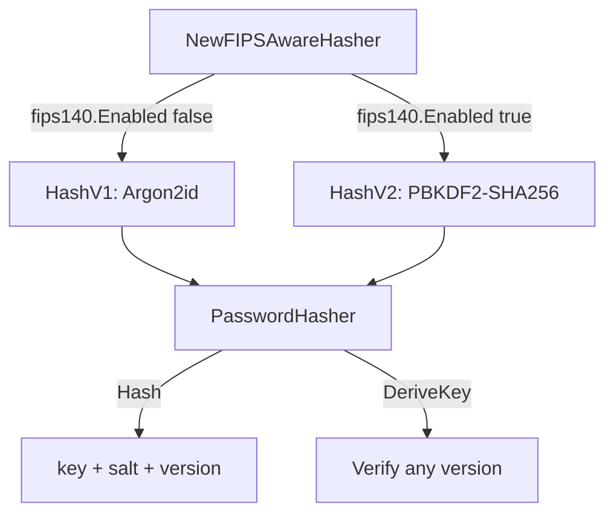

# FIPS 140 Strategy

## Overview

go-xkms provides FIPS 140 default-algorithm selection for the choices this
repository owns (the KDF selectors below), and reports FIPS build provenance
for artifact labels. Whether FIPS 140 mode is *active* in a process is
answered by the Go standard library alone (go-xkms #21) — this repository
keeps no copy of that signal.

**Packages**:
- `github.com/jeremyhahn/go-xkms/pkg/crypto/fips` -- build-provenance reporting (`Built`, `BuildSetting`) and KDF selection
- `github.com/jeremyhahn/go-xkms/pkg/crypto/kdf` -- `PasswordHasher` with versioned algorithms

## FIPS Mode Detection (owner ruling on #21, 2026-09-22)

```go
import "crypto/fips140"

if fips140.Enabled() {
    // the Go Cryptographic Module is active in this process
}
```

`crypto/fips140.Enabled()` is true under two conditions, and only these two:

- **Runtime**: `GODEBUG=fips140=on` or `GODEBUG=fips140=only` is set when the
  process starts. `=only` additionally refuses non-approved algorithms inside
  the stdlib crypto packages themselves; `=on` activates the module without
  that refusal.
- **Build time**: the binary was built with `GOFIPS140` set to an enabling
  value (`latest`, `inprocess`, `certified`, or `vX.Y.Z`), which activates the
  module by default without requiring `GODEBUG` at runtime.

**`GOFIPS140` set as a plain runtime environment variable does nothing.** It
is exclusively a `go build` / `go test -c` selector recorded into the binary
at link time; the Go runtime never reads it as a process environment variable
the way it reads `GODEBUG`. Earlier revisions of this package (`fips.Enabled`)
read `os.Getenv("GOFIPS140")` as if it were a runtime policy switch, and
`fips.Compiled` was `crypto/fips140.Enabled()` under another name; callers
combined them with `fips.Compiled() || fips.Enabled()`. Both functions are
deleted: `fips.Compiled()` was a redundant alias, and `fips.Enabled()` was a
runtime signal this repository invented that the toolchain does not honour.
Every caller now calls `crypto/fips140.Enabled()` directly.

```bash
# Enable FIPS mode at runtime (module active, non-approved algorithms still permitted)
GODEBUG=fips140=on ./xkmsd

# Enable FIPS mode at runtime with strict enforcement (non-approved algorithms refused)
GODEBUG=fips140=only ./xkmsd

# Enable FIPS mode at build time (module active by default, no GODEBUG needed)
GOFIPS140=latest go build ./cmd/xkmsd
```

## Build provenance

`fips.BuildSetting()` returns the `GOFIPS140` value the toolchain stamped into
the binary at link time — the `build GOFIPS140=<value>` line of
`go version -m` — and `fips.Built()` reports whether that value enables the
module. The stamp is fixed at link time, no environment variable alters it, and
it survives into a c-shared library a foreign process `dlopen()`s.

| Predicate | Answers | Moves with `GODEBUG=fips140` |
|-----------|---------|------------------------------|
| `crypto/fips140.Enabled()` | is the Go Cryptographic Module active in this process | **yes** |
| `fips.Built()` | was this artifact compiled with an enabling `GOFIPS140` | no |

The toolchain records the setting only when it enables the module, so a build
with no `GOFIPS140` and one with an explicit `GOFIPS140=off` both read back as
`""`. `BuildSetting()` reports the selector the build ran with (`latest`,
`inprocess`, `certified`, `v1.Y.Z`), so a compliance manifest can name the
module version rather than only the fact of a FIPS build.

Anything that **labels an artifact** — a token model string, a library banner, a
compliance manifest — uses `Built()`. The PKCS#11 module's
`CK_INFO.libraryDescription` and `CK_TOKEN_INFO.model` derive from it, so the
shipped `libxkms_pkcs11_fips.so` identifies itself as FIPS even when the loading
process sets `GODEBUG=fips140=off`, and a stock build never claims to be one
under `GODEBUG=fips140=on`.

`crypto/fips140.Enabled()` remains the one signal other packages in this
repository call directly to decide whether FIPS mode is active for their own
purposes (KDF selection below, the AEAD selector, PKCS#11 mechanism
advertisement — see [FIPS Mode Detection](#fips-mode-detection-owner-ruling-on-21-2026-09-22)
above). It does not decide whether a given *algorithm* may run. That decision
belongs to the Go standard library — see "Algorithm enforcement" below.

## Algorithm enforcement (owner ruling on #21, 2026-09-22)

go-xkms keeps no approved-algorithm allowlist of its own. Earlier revisions
of this package held one (`approvedAlgorithms`, `fips.ApprovedAlgorithm`,
`fips.AlgorithmPermitted`) that `pkg/validation` and `pkg/xkms/keyid`
consulted to reject a key ID naming a non-approved algorithm. It was deleted:
a hand-maintained list that has to be kept in sync with what the Go toolchain
actually enforces is a list that drifts, and the toolchain already enforces
its own answer correctly.

Under `GODEBUG=fips140=only`, or a binary built with an enabling `GOFIPS140`,
the standard library crypto package that implements an algorithm refuses it
on its own:

| Algorithm | Enforced by | Behavior under `fips140=only` |
|-----------|-------------|--------------------------------|
| RSA, ECDSA P-256/384/521, Ed25519 | `crypto/rsa`, `crypto/ecdsa`, `crypto/ed25519` | Approved; unaffected |
| AES-128/192/256-GCM | `crypto/aes`, `crypto/cipher` | Approved; unaffected (arbitrary-IV GCM has its own restriction — see [AEAD construction](#aead-construction)) |
| HMAC-SHA-256/384/512 | `crypto/hmac` | Approved; unaffected |
| ML-DSA-44/65/87 | `crypto/mldsa` (Go 1.26+) | Approved; refuses only under a build selecting the FIPS 140-3 Go Cryptographic Module v1.0.0, which predates ML-DSA support (`mldsa: unavailable in FIPS 140-3 Go Cryptographic Module v1.0.0`) |
| ML-KEM-768/1024 | `crypto/mlkem` | Approved; unaffected |
| X25519 | `crypto/ecdh` | Refused: `"use of X25519 is not allowed in FIPS 140-only mode"` |

`pkg/validation.isValidAlgorithm` and `pkg/xkms/keyid.validateAlgorithm` are
now grammar checks only — is `algo` a spelling either package recognizes —
never a FIPS policy decision. An algorithm this repository's grammar accepts
but the stdlib does not implement (`chacha20-poly1305`, `xchacha20-poly1305`,
`x448`, the `frost-*` ciphersuites) is unaffected by that grammar check
either way; nothing in this repository currently wires x448 or FROST to a key
generation backend, and ChaCha20-Poly1305's own FIPS posture is handled where
it is actually selected — see `pkg/crypto/aead.SelectOptimal`, which always
returns AES-256-GCM under `crypto/fips140.Enabled()` because
`golang.org/x/crypto/chacha20poly1305` is not part of the Go Cryptographic
Module and the toolchain cannot refuse it for us.

### Crypto the standard library cannot see

Two post-quantum parameter sets have no Go Cryptographic Module
implementation and stay on `github.com/cloudflare/circl`, a library outside
the module boundary that `crypto/fips140.Enabled()` cannot see and therefore
cannot refuse on its own:

| Algorithm | Package | Why CIRCL |
|-----------|---------|-----------|
| ML-KEM-512 | `pkg/quantum/mlkem512` | `crypto/mlkem` implements only the 768 and 1024 parameter sets |

`pkg/quantum/mlkem512.New` and `.Create` are this algorithm's one shared
seam: both refuse with `ErrFIPSMode` when `crypto/fips140.Enabled()` is true,
before any CIRCL call runs. Every other exported method operates on an
already-constructed `*MLKEM512`, so gating construction is sufficient.

Ed448, ML-DSA-44/65/87, and ML-KEM-768/1024 previously listed here as
CIRCL-backed now use `crypto/mldsa` and `crypto/mlkem` respectively (see the
table above); `pkg/quantum/dilithium2`, `pkg/quantum/mldsa65`,
`pkg/quantum/mldsa87`, `pkg/quantum/kyber768` and `pkg/quantum/mlkem1024`
wrap the standard library, not CIRCL. No production code path in this
repository currently implements Ed448 as a standalone signature algorithm
(it appears only as a FROST ciphersuite curve, gated as described above, and
as PKCS#11 curve/OID metadata).

## KDF Selection

The `fips` package provides default KDF selectors that the rest of the system uses to pick algorithms:

```go
kdf := fips.DefaultKDF()      // "argon2id" or "pbkdf2"
luksKDF := fips.DefaultLUKSKDF() // "argon2id" or "pbkdf2"
```

| Mode | `DefaultKDF()` | `DefaultLUKSKDF()` |
|------|----------------|--------------------|
| Standard | `argon2id` | `argon2id` |
| FIPS | `pbkdf2` | `pbkdf2` |

Argon2id is the default because it provides superior resistance to GPU/ASIC attacks. PBKDF2 is selected in FIPS mode because it is the only password-based KDF approved under NIST SP 800-132.

## PasswordHasher

`PasswordHasher` in `pkg/crypto/kdf` provides FIPS-aware password hashing with versioned algorithms. Both adapters (Argon2id and PBKDF2) are always initialized, allowing verification of hashes produced by any version regardless of the current mode.



### Versions

| Version | Algorithm | Parameters |
|---------|-----------|------------|
| `HashV1` | Argon2id | time=3, memory=64 MiB, threads=4, keyLen=32 |
| `HashV2` | PBKDF2-SHA256 | iterations=600,000, keyLen=32 |

Salt length is 32 bytes for both versions (minimum accepted: 16 bytes).

### Usage

```go
import "github.com/jeremyhahn/go-xkms/pkg/crypto/kdf"

// Auto-selects version based on FIPS mode.
hasher := kdf.NewFIPSAwareHasher()

// Hash a password (generates random salt).
key, salt, version, err := hasher.Hash([]byte("my-password"))

// Store key, salt, and version alongside the account record.

// Later: verify by re-deriving with the stored salt and version.
derived, err := hasher.DeriveKey([]byte("my-password"), salt, version)
// Compare derived == key using constant-time comparison.
```

### Explicit Version Selection

```go
// Force Argon2id regardless of FIPS mode.
hasher, err := kdf.NewPasswordHasher(kdf.HashV1)

// Force PBKDF2 regardless of FIPS mode.
hasher, err := kdf.NewPasswordHasher(kdf.HashV2)

// Check current mode.
if hasher.IsFIPS() {
    // Using PBKDF2
}
```

### Cross-Version Verification

A hasher created with any version can verify hashes from any other version, because both Argon2id and PBKDF2 adapters are always initialized internally:

```go
// Hash was created in standard mode (V1/Argon2id).
key, salt, version, _ := standardHasher.Hash(password)

// System later switches to FIPS mode (V2/PBKDF2).
fipsHasher := kdf.NewFIPSAwareHasher()

// Verification still works -- DeriveKey dispatches on the stored version.
derived, err := fipsHasher.DeriveKey(password, salt, version)
```

## Integration Points

The FIPS strategy is consumed by several subsystems:

| Subsystem | Usage |
|-----------|-------|
| Barrier seal/unseal | KDF for deriving data encryption keys |
| PlatformStore | Password hashing for stored credentials |
| User management | Account password hashing |
| LUKS passphrase derivation | KDF for disk encryption keys |
| Raw PKCS#1 v1.5 signatures | `Sign` / `Verify` with hash `NONE` on an in-process RSA key refuse with `types.ErrRawPKCS1v15Enforced` under `GODEBUG=fips140=only` (see [Hash selection](#hash-selection)) |
| AEAD auto-selection | Forces AES-256-GCM over ChaCha20-Poly1305 ([AEAD Auto-Selection](../configuration/aead-auto-selection.md)) |
| Key-ID grammar | `pkg/validation` and `pkg/xkms/keyid` validate spelling only; algorithm approval is enforced by the stdlib crypto package a caller reaches for, not here (go-xkms #21) |
| ML-KEM-512 | `pkg/quantum/mlkem512.New`/`.Create` refuse with `ErrFIPSMode` under `crypto/fips140.Enabled()`, since CIRCL is outside the module boundary the stdlib polices (see [Crypto the standard library cannot see](#crypto-the-standard-library-cannot-see)) |
| PKCS#11 authenticated wrapping | Refuses `C_WrapKeyAuthenticated` / `C_UnwrapKeyAuthenticated` with `CKR_MECHANISM_INVALID` when the runtime withholds arbitrary-IV GCM (see [AEAD construction](#aead-construction)) |

## Error Handling

```go
var (
    ErrHasherInvalidVersion  // unsupported hash version
    ErrHasherInvalidPassword // empty password
    ErrHasherInvalidSalt     // salt is nil or shorter than 16 bytes
)
```

## Hash selection

Digest strength is enforced separately from `GOFIPS140`, and it is
purpose-scoped the way SP 800-131A Rev. 2 is:

- **Signing, certificates, TPM attestation** -- MD4, MD5, SHA-1, MD5+SHA1 and
  RIPEMD-160 are refused by default. `crypto.allow_weak_hashes` re-admits them
  outside FIPS mode, applied by `server.New` and warned about on every start;
  under `GOFIPS140` / `GODEBUG=fips140` the setting is ignored. See
  [Weak hash policy](../crypto/weak-hashes.md).
- **Certificate display thumbprints** -- `certstore.ToString` (exported through
  the SDK as `CertToString`) prints a **SHA-256** fingerprint and no SHA-1 one.
  `crypto/sha1.Sum` *panics* under `GODEBUG=fips140=only` rather than returning
  an error, so any FIPS-activated process that formatted a certificate for
  display used to die there. The line is removed rather than guarded: the
  question a guard must ask is "is SHA-1 fatal in this process", the
  `fips140=only` *activation* state specifically, and no predicate answers it:
  `crypto/fips140.Enabled()` is true under both `fips140=on` and
  `fips140=only` and cannot distinguish them, and `fips.Built()` is
  provenance, which says nothing about how the process was started (#219). A
  guard would therefore fail open precisely for FIPS artifacts. `crypto/sha1`
  is no longer imported by the package. Consumers comparing against
  `openssl x509 -fingerprint` must pass `-sha256`.
- **Raw PKCS#1 v1.5 signatures (hash `NONE`)** -- `Sign` and `Verify` accept
  the hash name `NONE` to sign or check caller-built bytes verbatim, which is
  what PKCS#11's `CKM_RSA_PKCS` sends. Under `GODEBUG=fips140=only`,
  `crypto/rsa` admits a PKCS#1 v1.5 signature only under a digest it can
  classify as approved, and it *panics* on `crypto.Hash(0)` rather than
  returning an error. `types.CheckRawPKCS1v15` refuses first with
  `types.ErrRawPKCS1v15Enforced`; `pkg/xkms` wraps it in `ErrSigningFailed` /
  `ErrVerificationFailed`, and the `pkcs11test` mock backend returns it
  directly. The gate is `crypto/fips140.Enforced` -- the very variable
  `crypto/rsa` reads at that site, so it cannot disagree with the runtime --
  not `fips140.Enabled`, which is also true under `fips140=on`, where the raw
  form works and is left alone. Only in-process `*rsa.PrivateKey` /
  `*rsa.PublicKey` values are governed: a PKCS#11 or TPM signer builds its own
  `DigestInfo` and never reaches `crypto/rsa` (#486).
- **Key derivation** -- the approved set is per construction. The ANSI X9.63 /
  SP 800-56A concatenation KDFs accept SHA-1, SHA-224 and SHA3-224 in a fully
  compliant deployment, because SP 800-56A Rev. 3 approves them for KDF use and
  SP 800-131A Rev. 2 bars SHA-1 only from signature generation. See
  [Key Derivation Functions](../crypto/kdf.md).

## AEAD construction

`GODEBUG=fips140=only` refuses `cipher.NewGCM` and `cipher.NewGCMWithTagSize`
outright -- "use of GCM with arbitrary IVs is not allowed in FIPS 140-only
mode" -- while `fips140=on` permits the identical construction. AES-GCM itself
is approved (SP 800-38D); what the only mode forbids is an IV that arrives
from outside the FIPS module boundary.

`aead.ArbitraryIVGCMUsable` reports whether *this process* can perform
arbitrary-IV GCM. It is a runtime probe -- one throwaway seal, cached for the
life of the process -- for the same reason `types.HashUsable` is: `Available()`
reports linkage, `fips140.Enabled()` is true under both `on` and `only`, and
the standard library exports no predicate for the only mode. The PKCS#11
authenticated wrap verbs gate on it and answer `CKR_MECHANISM_INVALID`, the
code for a mechanism the token does not offer, rather than reporting the
regime restriction as an internal fault (#292).

### Random-nonce GCM for the default Encrypt path (#23)

`cipher.NewGCMWithRandomNonce` cannot honour a caller-chosen IV -- its
`NonceSize` is zero, and it generates the nonce internally -- so it is not a
substitute for `cipher.NewGCM` wherever a caller supplies its own nonce
(an interop wire format, or a nonce derived through a KDF) or asks for a
truncated tag, which `NewGCMWithRandomNonce` cannot produce. Those calls
still fail closed under `fips140=only` with
`aead.ErrArbitraryIVGCMUnavailable`: Vault Transit's BYOK wrap
(`pkg/backend/vault/vault_importexport.go`), whose wire format mandates a
fixed all-zero nonce, is one such caller.

It *is* the substitute for the one combination every symmetric backend's
default `Encrypt` call uses when neither of those applies: no caller-supplied
nonce, and the default full 128-bit tag. `pkg/crypto/aead.NewGCMForFreshEncrypt`
makes that substitution under `fips140=only` and reports it back as
`randomNonce`; `pkg/crypto/aead.NewGCMForDecrypt` takes the same boolean (read
off the ciphertext's own recorded `types.GCMNonceMode`, never off the
decrypting process's FIPS posture) and rebuilds the matching construction. The
symmetric (`pkg/keyprovider/symmetric`), Azure Key Vault
(`pkg/backend/azurekv`) and TPM2 (`pkg/tpm2`) AES-GCM implementations all
route through this pair rather than calling `NewGCM` directly.

This changes the ciphertext framing -- `NewGCMWithRandomNonce`'s `Seal`
generates a 96-bit nonce, prepends it to its output, and reports `Overhead()`
as nonce+tag combined -- so `GCMNonceMode` is `GCMNonceModeExplicit`, the
zero value, unless a `fips140=only` process actually produced the ciphertext
with the random-nonce construction. The on-disk TLV envelope
(`pkg/keyprovider/symmetric.Marshal`/`Unmarshal`) records the mode in one
marker byte that always follows the version byte; there is only one wire
version, and the earlier version that had no marker byte is no longer
accepted -- `Unmarshal` refuses it with a typed error naming the removed
format, rather than reading it through a dual reader.

A `fips140=only` process cannot open a `GCMNonceModeExplicit` (legacy,
caller-nonce) ciphertext either, for the identical reason `NewGCM` itself is
refused: arbitrary-IV GCM is what the mode forbids, on `Open` exactly as on
`Seal`. That is expected, not a regression introduced by this capability --
the ciphertext was never rewritten, and a process that can construct
arbitrary-IV GCM (the default, and `fips140=on`) still opens it.

## Panics the stdlib raises instead of returning an error (#23)

Most FIPS 140-only refusals in the Go standard library return an `error` a
caller can handle. A few APIs predate that convention, or have no error
return to give the refusal in the first place, and **panic** instead:

| API | Panics when |
|-----|-------------|
| `golang.org/x/crypto/hkdf.New`/`.Extract` (wraps `crypto/hkdf.Extract`) | HKDF input keying material is under 112 bits, or the hash is not SHA-2/SHA-3 |
| `crypto/sha1.Sum`, `(*digest).Sum` | Always, under `fips140=only` |
| `golang.org/x/crypto/pbkdf2.Key` (wraps `crypto/pbkdf2.Key`) | PBKDF2 salt is under 128 bits |
| `crypto/hmac.New` | HMAC key is under 112 bits, or the hash is not SHA-2/SHA-3 (no error return exists to use instead) |
| `crypto/cipher.NewCFBEncrypter`/`NewCFBDecrypter` | Always, under `fips140=only` |

A production call site reaching one of these with attacker- or
operator-supplied input crashes the whole process on one bad request, not
just that request -- measured against `pkg/ca`'s OCSP responder (an
ordinary, RFC 6960-default SHA-1 request) and `pkg/acme/server/handlers`'s
EAB verifier (a merely-short operator-provisioned HMAC key), both reachable
without authentication. Two dispositions apply, and no third one does — this
repository does not maintain a pre-flight length/algorithm check as a
substitute for either:

- **The stdlib has a modern, error-returning equivalent.** `crypto/hkdf.Key`
  (Go 1.24+) replaces `golang.org/x/crypto/hkdf.New`; every production HKDF
  call site in this repository (`pkg/crypto/kdf`, `pkg/crypto/ecdh`,
  `pkg/crypto/x25519`, `pkg/seal`, `pkg/trust/clusterca`,
  `pkg/keyprovider/pkcs8`) uses it. `github.com/youmark/pkcs8`'s default
  8-byte PBKDF2 salt is replaced with an explicit 16-byte
  `pkcs8.PBKDF2Opts` in `pkg/encoding` and `pkg/keyprovider/pkcs8` instead --
  the salt size is a caller-supplied option, not a construction with no
  error-returning alternative.
- **No such equivalent exists** (`crypto/sha1.Sum`, `crypto/hmac.New`,
  `crypto/cipher` CFB). The call is wrapped in a function-local
  `recover`/typed-error boundary at the point that calls it --
  `pkg/ca.tbsCertificateDigest` (X.509 signature verification, SHA-1 or
  MD5), `pkg/acme/server/handlers.extendPCR` (TPM event-log PCR replay,
  SHA-1 bank) and `.computeHMAC` (EAB MAC verification) -- converting the
  panic into the same typed error the function already returns for an
  ordinary verification failure, per Effective Go's guidance that `recover`
  belongs at a boundary that turns a panic into an error return. This is not
  a blanket recover: each one sits immediately around the single call that
  can panic, in a function whose contract is already "verify and return
  ok/error," so a genuinely unexpected panic elsewhere in the same package
  still crashes the process as it should.

## See Also

- [Weak hash policy](../crypto/weak-hashes.md) -- signature-side digest policy
- [Key Derivation Functions](../crypto/kdf.md) -- per-construction hash sets
- [Configuration: AEAD](../configuration/aead-auto-selection.md) -- authenticated encryption setup
- [Architecture: Symmetric Encryption](../architecture/symmetric-encryption.md) -- symmetric key architecture
