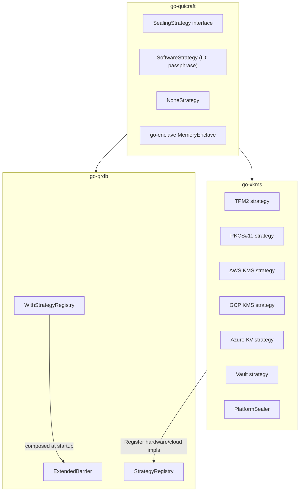

# Barrier Encryption Architecture

The barrier subsystem provides transparent at-rest encryption for the
`storage.Backend` layer. A `Barrier` wraps any storage backend and encrypts
every value with AES-256-GCM (or whichever AEAD the active epoch nominates)
before it reaches the underlying store. Keys (paths) remain in plaintext;
only values are encrypted.

go-xkms is the **canonical home for every hardware-backed and cloud-KMS
sealing strategy** in the stack. It owns the implementations; go-qrdb owns
the barrier itself and the `StrategyRegistry` plug point that xkms registers
into at composition time. There is no hardware code in qrdb. The embedded qrdb SDK node
uses `pkg/server.BuildTenantInfra` (shared with the daemon) to wire per-tenant
isolation and per-tenant enable-encryption support.

There is exactly **one barrier** at runtime. How it is provisioned depends on
the deployment:

**Node-barrier mode (embedded qrdb, the secure default).** When
`storage.backend: qrdb`, `barrier.enabled: true`, and the strategy is one
`config.BarrierConfig.NodeFlipWired` reports true for — `none`, `passphrase`,
`shamir`, or `tpm2` — xkms uses the **qrdb node's own barrier**. The node
encrypts its entire PebbleDB data plane with `encfs` (file-level AES-256-GCM),
and xkms adopts the node's barrier, registry, and tenant service as its own
(`pkg/server/node_seal.go` + `qrdb_node.go`; mirrors go-quicbaas, so both
products drive the identical shared mechanism). `none` and a provisioned
`tpm2` auto-unseal unattended at construction; `passphrase` and `shamir`
leave the node sealed and block `Server.New` behind the qrdb node's own
sealed-window listener — go-qrdb's `sdk/go/node` package implements the
identical two-phase boot `cmd/qrdbd` uses (`initSealSubsystem` ->
`awaitUnseal`), driven here entirely through `go-qrdb/sdk/go`, never a
parallel implementation — until an operator completes `xkmsctl barrier
unseal` (or `unseal-shares`) or the equivalent API call, or the configured
`barrier.sealed_window_timeout` elapses. Either way, **every value at rest —
including the crypto backends' key stores — is encrypted** once `Server.New`
returns: "passphrase"/"shamir" gate *access* to encrypted data behind an
operator ceremony, they do not leave it in plaintext. `tpm2` is built by
`resolveNodeSeal` directly from `Backends.TPM2` config (device path,
simulator settings) — never from an already-initialized backend — so the
flip has no dependency on backend initialization, which now runs strictly
after the node is unsealed (see the "Backend credential resolution" section
below). `pkcs11` and the cloud-KMS strategies are not yet wired to the flip
(`NodeFlipWired` reports false) — see the PKCS#11 caveat below — and fall
back to own-barrier mode. The daemon refuses to start a `qrdb` + barrier
deployment on a strategy that isn't wired to the flip; there is no override,
so a plaintext data plane is never the default, silent or otherwise.

**Own-barrier mode (fallback).** For non-`qrdb` storage (file/pebble), or a
barrier strategy `NodeFlipWired` excludes (`pkcs11`, the cloud-KMS
strategies), xkms builds its own `StorageBarrier` over the store
(`initializeBarrier`), injecting the hardware seal strategies via
`pkg/server/seal_strategies.go::buildHardwareSealStrategies` — built from
already-initialized backends, which is exactly why these strategies cannot
be wired to the node flip: initializeBackends now runs after unseal (see
below), so building a barrier strategy from a backend here comes after
initializeBarrier, still its long-standing position late in `Server.New`.
The `passphrase` strategy is the always-available baseline. This barrier
starts **sealed** and is operator-unsealed via `xkmsctl barrier unseal` (or
`unseal-shares`) or the equivalent API call, on every restart — there is no
boot-time secret to supply.

**Backend credential resolution (go-xkms#653 approved item 2).**
`Server.New` builds the seal subsystem and completes unseal
(`initializeQRDBStorage`), then the credential service and
`resolveConfigSecrets` (the one-pass `credential://` walk over the whole
loaded configuration), and only then `initializeBackends`. A `credential://`
reference for any of the five backend-credential fields —
`backends.pkcs11.pin`, `rng.pkcs11.pin`, `backends.awskms.secret_key`,
`backends.azurekv.client_secret`, `backends.vault.token` — now resolves
through the same pass a CA password or the phone backend's Noise static key
already used; see `docs/xkmsd-configuration/engineering.md` and
`pkg/server/secret_wiring_test.go`'s
`TestBackendCredentials_ResolveViaCredentialReference`.

**Provisioning (config / CLI / env — the same surface every stack product
uses):**
- `barrier.strategy`: `none | passphrase | shamir | tpm2 | pkcs11 | awskms |
  gcpkms | azurekv | vault` (canonical vocabulary).
- Software strategies (`passphrase`/`shamir`) never auto-unseal: there is no
  config, flag, or environment field for the secret (go-xkms#653 removed
  `barrier.passphrase`, `--seal-passphrase`, and `XKMS_BARRIER_PASSPHRASE`
  entirely). The operator supplies the passphrase or Shamir quorum at
  Initialize/Unseal time, every restart, via `xkmsctl barrier unseal` (or
  `unseal-shares`) or the equivalent API call, against the sealed-window
  listener when `NodeFlipWired` (`storage.backend: qrdb`) or the always-on
  barrier API otherwise — an old config or environment that still sets the
  removed fields fails `Load` with a typed `*config.RemovedFieldError`.
- Hardware strategies (`tpm2`/…) auto-unseal from the device (PCR policy / empty
  credentials) — no boot secret needed. The TPM seal open is shared with the
  general TPM2 backend (a single device open). **The PKCS#11 seal strategy is
  not wired to the node flip and its PIN is not deferred to unseal time the
  way the passphrase strategy's secret is** (go-xkms#653 item 3, not
  approved): `buildHardwareSealStrategies` needs the already-initialized
  PKCS#11 backend from `s.keyProviders`, which now builds after unseal and
  credential resolution — the identical cycle a deferred PIN would need to
  break, requiring a `pkg/seal`/`types.Sealer` interface change this repo
  has not been authorized to make.

## Three-Layer Architecture

The barrier implementation is split across three repositories so each layer
reuses the right amount of the surface:

| Layer | Repository | Package | Provides |
|-------|-----------|---------|----------|
| Interfaces + KDFs | **go-quicraft** | `pkg/seal` | `SealingStrategy`, `Barrier`, `SymmetricEncrypter`, go-enclave `MemoryEnclave`, passphrase (`SoftwareStrategy`), `NoneStrategy` |
| Rich barrier + registry | **go-qrdb** | `pkg/seal` | `ExtendedBarrier` (Shamir, multi-tenant, recovery keys, root tokens, rekey), `StrategyRegistry`, server option `WithStrategyRegistry` |
| Hardware + cloud strategies | **go-xkms** | `pkg/seal` | `SealingStrategy` implementations for TPM2, PKCS#11, AWS KMS, GCP KMS, Azure KV, Vault; `PlatformSealer`; tenant barrier registry |

qrdb owns only the `passphrase` baseline (the software/password-derived
strategy, ID `passphrase`) and the `None` passthrough — both re-exported
from quicraft. Every hardware-backed or cloud-KMS strategy
(TPM2, PKCS#11, AWS KMS, GCP KMS, Azure KV, Vault) lives **exclusively** in
this repository and is injected into the qrdb server at composition time via
`qrdbserver.WithStrategyRegistry`. quicbaas wires the two together; that
composition is documented in the locked architecture.

The `pkg/seal` package in go-xkms contains:

- **Hardware strategy implementations**: `strategy_tpm2.go`, `strategy_pkcs11.go`, `strategy_cloud.go`
- **Shamir strategy adapter**: composes quicraft's Shamir secret-sharing into the same registry
- **PlatformSealer**: `platform_sealer.go` for sealing arbitrary data with backend tagging
- **Barrier wrapper**: `barrier.go` composes the qrdb `ExtendedBarrier` with the locally-registered strategies
- **Tenant barriers**: `tenant_barrier.go`, `barrier_registry.go` for multi-tenant isolation

### Registration into qrdb's `StrategyRegistry`

Hardware strategies are not loaded by qrdb directly. xkms exposes a
constructor for each strategy and the composing binary (quicbaas, xkmsd)
registers them:

```go
import (
    qrdbseal "github.com/jeremyhahn/go-qrdb/pkg/seal"
    qrdbserver "github.com/jeremyhahn/go-qrdb/pkg/server"

    xkmsseal "github.com/jeremyhahn/go-xkms/pkg/seal"
)

registry := qrdbseal.NewStrategyRegistry()
_ = registry.Register(qrdbseal.StrategyTPM2,    xkmsseal.NewTPM2StrategyFactory(tpmSealer))
_ = registry.Register(qrdbseal.StrategyPKCS11,  xkmsseal.NewPKCS11StrategyFactory(p11))
_ = registry.Register(qrdbseal.StrategyAWSKMS,  xkmsseal.NewAWSKMSStrategyFactory(kmsClient))

srv, err := qrdbserver.New(
    qrdbserver.WithStrategyRegistry(registry),
    // ...
)
```

The passphrase (and None) strategies are pre-registered by qrdb itself.
xkms contributes only the hardware/cloud strategies; nothing else changes
about the barrier API the server uses.

### Hardware-vs-software ownership



### Import Paths

```go
import (
    // go-qrdb barrier (ExtendedBarrier, StrategyRegistry, server options)
    qrdbseal   "github.com/jeremyhahn/go-qrdb/pkg/seal"
    qrdbserver "github.com/jeremyhahn/go-qrdb/pkg/server"

    // go-xkms hardware/cloud strategies + PlatformSealer + tenant registry
    "github.com/jeremyhahn/go-xkms/pkg/seal"
)
```

## Architecture Overview

```
  Application
      |
  KeyStore / xKMSService
      |
  storage.Backend  (Barrier)          -- go-xkms pkg/seal (wrapper)
      |                |
      |   ExtendedBarrier              -- go-qrdb pkg/seal
      |       |
      |   StrategyAdapter(s)           -- go-xkms pkg/seal/adapter.go
      |       |
      |   SealingStrategy impls        -- go-xkms (TPM2, PKCS#11, Cloud KMS)
      |                |
      |   encrypt(DEK, value) / decrypt(DEK, ciphertext)
      |                |
  storage.Backend  (file, memory, pebble, qrdb)
      |
  Persistent Storage
```

The Barrier sits between the application's key store and the raw storage backend. It implements `storage.Backend` itself, so any code expecting a storage backend can use a Barrier without modification.

## Seal/Unseal Lifecycle

```
             Initialize(creds)
                   |
                   v
  +----------+         +------------+
  |  SEALED  | ------> |  UNSEALED  |
  |  (init)  |  Unseal |            |
  +----------+ <------ +------------+
                  Seal
```

**States:**

| State | DEK Available | Storage Operations | Transitions To |
|-------|---------------|-------------------|----------------|
| Sealed (default) | No | All return `ErrSealed` | Unsealed (via `Initialize` or `Unseal`) |
| Unsealed | Yes | Encrypt on write, decrypt on read | Sealed (via `Seal` or `Close`) |

**Lifecycle:**

1. **Initialize** -- Called once for a new barrier. Generates a 32-byte root key, seals it with the best available strategy, persists the sealed blob, derives the DEK, and transitions to unsealed.
2. **Unseal** -- Loads the persisted sealed root key blob, unseals it with the matching strategy, derives the DEK, and transitions to unsealed.
3. **Seal** -- Zeros the DEK in memory and transitions to sealed. All subsequent operations return `ErrSealed`. Idempotent.
4. **Close** -- Calls `Seal`, then closes the underlying storage backend.

## Root Key Management

### Generation

On `Initialize`, a 32-byte root key is generated from `crypto/rand`:

```go
rootKey := make([]byte, 32)
io.ReadFull(rand.Reader, rootKey)
```

### Sealing

The root key is sealed by the best available `SealingStrategy` and persisted as a JSON-encoded `SealedRootKey` blob at the configured `RootKeyPath` in the underlying storage backend.

### DEK Derivation

A Data Encryption Key (DEK) is derived from the root key using HKDF-SHA256:

```
DEK = HKDF-SHA256(rootKey, salt=nil, info="go-xkms/barrier/v1", length=32)
```

The root key is zeroed immediately after DEK derivation. The DEK is held in memory only while the barrier is unsealed.

### Key Zeroing

- Root key: zeroed immediately after DEK derivation.
- DEK: zeroed when `Seal()` or `Close()` is called.
- Zeroing uses a byte-by-byte overwrite loop.

## Encrypted Value Format

Every value stored through the barrier is encrypted as:

```
+----------+----------+----------------------------+
| version  |  nonce   |    ciphertext + GCM tag    |
|  1 byte  | 12 bytes |      variable length       |
+----------+----------+----------------------------+
```

| Field | Size | Description |
|-------|------|-------------|
| version | 1 byte | Format version (currently `0x01`) |
| nonce | 12 bytes | Random AES-GCM nonce from `crypto/rand` |
| ciphertext + tag | N + 16 bytes | AES-256-GCM encrypted payload with 16-byte authentication tag |

Minimum encrypted value size: 29 bytes (1 + 12 + 16).

## Sealing Strategies

Each strategy implements the `SealingStrategy` interface:

```go
type SealingStrategy interface {
    ID() StrategyID
    Available() bool
    HardwareBacked() bool
    SealRootKey(ctx context.Context, rootKey []byte, creds Credentials) (*SealedRootKey, error)
    UnsealRootKey(ctx context.Context, sealed *SealedRootKey, creds Credentials) ([]byte, error)
}
```

### Strategy Comparison

| Strategy | ID | Hardware | Owned By | Key Protection | Credentials Used |
|----------|----|----------|----------|----------------|-----------------|
| None | `none` | No | quicraft (re-export from qrdb) | No encryption (passthrough) | None |
| Passphrase | `passphrase` | No | quicraft (re-export from qrdb) | Argon2id or PBKDF2 + AES-256-GCM | Passphrase |
| Shamir | `shamir` | No | quicraft | M-of-N split of the root key | None (root key is the secret) |
| TPM 2.0 | `tpm2` | Yes | **go-xkms** | TPM SRK hierarchy, optional PCR binding | May carry an SRK auth value |
| PKCS#11 | `pkcs11` | Yes | **go-xkms** | HSM token wrapping key | N/A (token session auth) |
| AWS KMS | `awskms` | Yes | **go-xkms** | AWS KMS CMK envelope encryption | N/A (IAM/external auth) |
| GCP KMS | `gcpkms` | Yes | **go-xkms** | GCP KMS key ring envelope encryption | N/A (IAM/external auth) |
| Azure KV | `azurekv` | Yes | **go-xkms** | Azure Key Vault key encryption | N/A (Azure AD auth) |
| Vault | `vault` | Yes | **go-xkms** | HashiCorp Vault transit engine | N/A (Vault token auth) |

> Every strategy marked "go-xkms" is registered into qrdb's
> `StrategyRegistry` at composition time. qrdb itself ships only `none`,
> `passphrase`, and `shamir`; reaching into qrdb directly for TPM2/PKCS#11
> code is an architectural error.

### Default Preference Order

When `BarrierConfig.PreferenceOrder` is not set, the barrier selects the first available strategy in this order:

1. `tpm2`
2. `pkcs11`
3. `awskms`
4. `gcpkms`
5. `azurekv`
6. `vault`
7. `passphrase`

Hardware-backed strategies are always preferred over the passphrase fallback.

### Passphrase Strategy Details

The passphrase strategy (Go type `SoftwareStrategy`, ID `passphrase`) uses
Argon2id for password-based key derivation:

| Parameter | Value |
|-----------|-------|
| Time cost | 4 iterations |
| Memory cost | 128 MiB |
| Parallelism | 4 threads |
| Key length | 32 bytes |
| Salt length | 32 bytes (random) |

These are go-quicraft's `DefaultKDFParams()`, which is the authority — a
deployment may seal at a higher factor, and that tuned factor is carried
forward across a password change rather than reset to these defaults.

Under FIPS (a `fips` build or `GODEBUG=fips140=only`) the strategy derives with
PBKDF2-SHA256 at 600,000 iterations instead; a blob stays on the leg it was
sealed with.

Process:
1. Generate 32-byte random salt
2. Derive 32-byte key: `Argon2id(password, salt, t=4, m=128 MiB, p=4)`
3. Generate 12-byte random nonce
4. Encrypt root key: `AES-256-GCM(derivedKey, nonce, rootKey)`
5. Persist `SealedRootKey{salt, nonce, ciphertext}`

### Hardware Strategy Details (TPM2, PKCS#11, Cloud KMS)

Hardware strategies delegate to the `types.Sealer` interface:

```go
type Sealer interface {
    Seal(ctx context.Context, data []byte, opts *SealOptions) (*SealedData, error)
    Unseal(ctx context.Context, sealed *SealedData, opts *UnsealOptions) ([]byte, error)
    CanSeal() bool
}
```

The root key is wrapped by the hardware backend and stored as `SealedRootKey.SealedData`. The `Credentials.Secret` field is unused for cloud KMS strategies (authentication is handled externally via IAM, service accounts, etc.).

## PlatformSealer

`PlatformSealer` is a separate component that provides a `types.Sealer` implementation for sealing arbitrary data (not just root keys) across multiple backend sealers. It automatically tags sealed data with the strategy used and routes unseal operations to the correct backend.

```go
sealer, _ := seal.NewPlatformSealer(logger, config, sealerMap)

// Seal with best available strategy
sealed, _ := sealer.Seal(ctx, plaintext, nil)

// Unseal (automatically routes to correct backend)
plaintext, _ := sealer.Unseal(ctx, sealed, nil)

// Seal with a specific strategy
sealed, _ = sealer.SealWith(ctx, seal.StrategyTPM2, plaintext, nil)
```

## Configuration

### BarrierConfig

```go
type BarrierConfig struct {
    // Strategy selection order. First available wins.
    // Default: tpm2 > pkcs11 > awskms > gcpkms > azurekv > vault > software
    PreferenceOrder []StrategyID

    // Storage key for the sealed root key blob. Must be non-empty.
    RootKeyPath string

    // Audit logger for seal/unseal events. Nil disables audit logging.
    AuditLogger audit.Logger
}
```

### SealerConfig (for PlatformSealer)

```go
type SealerConfig struct {
    PreferenceOrder []StrategyID
    AuditLogger     audit.Logger
}
```

## Audit Logging

All barrier operations emit audit events when an `AuditLogger` is configured:

| Action | Resource | Outcome |
|--------|----------|---------|
| `initialize` | `barrier` | `allow` on success, `deny` on failure |
| `unseal` | `barrier` | `allow` on success, `deny` on failure |
| `seal` | `barrier` | `allow` |

Audit failures are silently ignored to avoid blocking barrier operations.

## Error Reference

| Error | Condition |
|-------|-----------|
| `ErrSealed` | Storage operation attempted while barrier is sealed |
| `ErrAlreadyUnsealed` | `Unseal` called on an already-unsealed barrier |
| `ErrAlreadyInitialized` | `Initialize` called when root key already exists |
| `ErrNotInitialized` | `Unseal` called before `Initialize` |
| `ErrDecryptionFailed` | Wrong passphrase under the software strategy |
| `ErrInvalidCredentials` | Wrong token or auth value under a hardware strategy |
| `ErrNoAvailableStrategy` | No registered strategy reports as available |
| `ErrStrategyNotFound` | Sealed blob references an unregistered strategy |
| `ErrStrategyMismatch` | PlatformSealer metadata missing strategy tag |
| `ErrCorruptRootKey` | Root key blob failed to deserialize or has wrong format |
| `ErrNilSealedData` | Nil pointer passed to unseal operation |
| `ErrEncryptorNotAvailable` | Encryptor not available (barrier not unsealed) |
| `ErrHardwareEncryptorRequired` | Master key not exportable from hardware-backed strategy |

## Security Properties

- **Encryption**: AES-256-GCM with random 12-byte nonces (NIST SP 800-38D).
- **Key derivation**: HKDF-SHA256 (RFC 5869) for DEK derivation from root key.
- **Password KDF**: Argon2id (RFC 9106) with 64 MiB memory cost for software strategy.
- **Key zeroing**: Root key and DEK are explicitly zeroed when no longer needed.
- **Atomic state**: Lock-free `atomic.Int32` for seal state, `atomic.Value` for DEK and strategy. No mutex contention on hot paths.
- **Nonce uniqueness**: Each encrypt operation generates a fresh random nonce. With AES-256-GCM and 96-bit nonces, the birthday bound is ~2^48 encryptions under the same key.
- **No key in plaintext on disk**: The root key is always wrapped by a sealing strategy before being persisted.

## Threat Model

| Threat | Mitigation |
|--------|------------|
| Storage compromise (disk theft) | All values encrypted with AES-256-GCM |
| Root key extraction from memory | DEK zeroed on seal; root key zeroed immediately after derivation |
| Brute-force password attack | Argon2id with 64 MiB memory cost (software strategy) |
| Replay of sealed root key | Hardware strategies bind to specific hardware identity (TPM SRK, HSM slot) |
| Downgrade to weaker strategy | Sealed root key records the strategy ID; unseal requires matching strategy |

## Go API Examples

### Basic Barrier Usage

```go
package main

import (
    "context"
    "log/slog"

    "github.com/jeremyhahn/go-xkms/pkg/seal"
    "github.com/jeremyhahn/go-xkms/pkg/storage/memory"
)

func main() {
    logger := slog.Default()
    base := memory.New()

    barrier, err := seal.NewBarrier(
        logger,
        base,
        seal.BarrierConfig{
            RootKeyPath: "sys/barrier/root-key",
        },
        seal.NewSoftwareStrategy(),
    )
    if err != nil {
        panic(err)
    }
    defer barrier.Close()

    ctx := context.Background()
    creds := seal.Credentials{Secret: "my-secure-passphrase"}

    // First-time initialization
    if err := barrier.Initialize(ctx, creds); err != nil {
        panic(err)
    }

    // Store encrypted data
    if err := barrier.Put(ctx, "secrets/db-password", []byte("hunter2")); err != nil {
        panic(err)
    }

    // Retrieve and decrypt
    plaintext, err := barrier.Get(ctx, "secrets/db-password")
    if err != nil {
        panic(err)
    }
    // plaintext == []byte("hunter2")

    // Seal the barrier
    barrier.Seal()

    // All operations now return ErrSealed
    _, err = barrier.Get(ctx, "secrets/db-password")
    // err == seal.ErrSealed

    // Unseal to resume
    if err := barrier.Unseal(ctx, creds); err != nil {
        panic(err)
    }
}
```

### Multi-Strategy Barrier

```go
barrier, err := seal.NewBarrier(
    logger,
    base,
    seal.BarrierConfig{
        RootKeyPath: "sys/barrier/root-key",
        PreferenceOrder: []seal.StrategyID{
            seal.StrategyTPM2,
            seal.StrategyPassphrase,
        },
    },
    seal.NewTPM2Strategy(tpmSealer),
    seal.NewSoftwareStrategy(), // ID() == seal.StrategyPassphrase
)
```

### PlatformSealer for Arbitrary Data

```go
sealers := map[seal.StrategyID]types.Sealer{
    seal.StrategyTPM2:       tpmSealer,
    seal.StrategyPassphrase: softwareSealer,
}

platformSealer, err := seal.NewPlatformSealer(logger, seal.SealerConfig{}, sealers)
if err != nil {
    panic(err)
}

sealed, err := platformSealer.Seal(ctx, []byte("sensitive data"), nil)
// sealed.Metadata["seal:strategy"] == "tpm2" (or whichever was best)

plaintext, err := platformSealer.Unseal(ctx, sealed, nil)
```

## Shamir Secret Sharing (StrategyShamir)

The `shamir` strategy splits the root key itself into M-of-N Shamir shares using `pkg/threshold/shamir`. Unlike credential-based strategies where a password protects the root key, the root key IS the Shamir secret. No password is needed for initialization or unsealing.

| Strategy | ID | Hardware | Key Protection | Credentials Used |
|----------|----|----------|----------------|-----------------|
| Shamir | `shamir` | No | M-of-N Shamir secret sharing | None (root key is the secret) |

### Dual-Mode Operation

All Shamir barrier methods operate in one of two modes depending on whether `StrategyShamir` is registered:

| Mode | Strategy Registered | Shamir Secret | Use Case |
|------|-------------------|---------------|----------|
| **Direct** | `StrategyShamir` | Root key itself | Multi-party root key custody |
| **Credential** | Any other (e.g. `passphrase`) | Credential password | Password-based unsealing with quorum |

In direct mode, reconstructed shares yield the root key directly. In credential mode, reconstructed shares yield the password that is then passed to the underlying strategy's `UnsealRootKey`.

### Configuration

```go
seal.BarrierConfig{
    RootKeyPath:     "sys/barrier/root-key",
    PreferenceOrder: []seal.StrategyID{seal.StrategyShamir},
    Shamir: &seal.ShamirConfig{
        Threshold:   3,  // M: minimum shares to reconstruct
        TotalShares: 5,  // N: total shares generated
    },
}
```

`ShamirConfig` must be set on `BarrierConfig.Shamir` for any Shamir method to work. The `Threshold` must be >= 2 and <= `TotalShares`.

### Initialization

`InitializeShamir` generates a root key, seals it with the best available strategy, and splits the secret into N shares:

```go
shamirStrat, _ := seal.NewShamirStrategy(shareStore, 3, 5)

barrier, _ := seal.NewBarrier(logger, base, seal.BarrierConfig{
    RootKeyPath:     "sys/barrier/root-key",
    PreferenceOrder: []seal.StrategyID{seal.StrategyShamir},
    Shamir:          &seal.ShamirConfig{Threshold: 3, TotalShares: 5},
}, shamirStrat)

result, err := barrier.InitializeShamir(ctx, seal.Credentials{})
// result.Shares: ["base64share1", "base64share2", ..., "base64share5"]
// result.Threshold: 3
// result.TotalShares: 5
// Distribute shares to key holders. The barrier is now unsealed.
```

### Share-Based Unsealing

Two methods support unsealing from Shamir shares:

**Stateful (one-at-a-time):** `UnsealWithShare` accumulates shares in an internal quorum accumulator with a 5-minute TTL. When the threshold is met, the barrier unseals automatically.

```go
progress, _ := barrier.UnsealWithShare(ctx, shares[0])
// progress.Required: 3, progress.Submitted: 1, progress.Complete: false

progress, _ = barrier.UnsealWithShare(ctx, shares[1])
// progress.Submitted: 2, progress.Complete: false

progress, _ = barrier.UnsealWithShare(ctx, shares[2])
// progress.Submitted: 3, progress.Complete: true
// Barrier is now unsealed.
```

The accumulator rejects duplicate shares (`ErrShamirDuplicateShare`) and resets if the TTL expires (`ErrShamirQuorumExpired`).

**Stateless (batch):** `UnsealWithShares` takes all shares in a single call.

```go
err := barrier.UnsealWithShares(ctx, shares[:3])
// Barrier is now unsealed (or error if shares are invalid).
```

### Rekey (Share Rotation)

`Rekey` generates new Shamir shares for the existing root key without changing the root key itself. The barrier must be unsealed and `StrategyShamir` must be registered.

```go
result, err := barrier.Rekey(ctx, 4, 7)
// Old shares are deleted. New 4-of-7 shares returned.
// result.Shares: ["newshare1", ..., "newshare7"]
// The root key and DEK are unchanged.
```

Use this when an operator leaves and their share must be invalidated.

### Recovery Keys

Recovery keys are an independent Shamir split of the DEK (not the root key) for disaster recovery. The shares are returned for offline storage and are NOT persisted.

```go
// Generate (barrier must be unsealed)
result, err := barrier.GenerateRecoveryKeys(ctx, 3, 5)
// result.Shares: store these offline (paper, safe deposit boxes)
// Only metadata (threshold/total) is persisted.

// Recover (barrier must be sealed)
err = barrier.RecoverWithKeys(ctx, recoveryShares[:3])
// Barrier is now unsealed with the recovered DEK.

// Check and delete
exists, _ := barrier.HasRecoveryKeys()
err = barrier.DeleteRecoveryKeys()
```

### Root Token Generation

`GenerateRootToken` produces a one-time admin token by proving knowledge of the master key through Shamir share reconstruction. The token is `HMAC-SHA256(DEK, random_nonce || "go-xkms/root-token/v1")`.

```go
token, err := barrier.GenerateRootToken(ctx, shares[:3])
// token.Token: hex-encoded HMAC-SHA256 value
// token.CreatedAt: time.Time
// The barrier state is unchanged (works whether sealed or unsealed).
```

The caller provides enough shares to reconstruct the secret. In direct mode, the reconstructed root key is verified by deriving the DEK and performing a canary encrypt/decrypt cycle. In credential mode, the password is verified by unsealing the root key blob.

### Shamir Error Reference

| Error | Condition |
|-------|-----------|
| `ErrShamirNotConfigured` | `BarrierConfig.Shamir` is nil |
| `ErrShamirThresholdInvalid` | Threshold < 2 or threshold > total |
| `ErrShamirDuplicateShare` | Same share submitted twice to accumulator |
| `ErrShamirQuorumExpired` | Accumulator TTL (5 min) elapsed |
| `ErrShamirQuorumIncomplete` | Not enough shares provided |
| `ErrShamirCombineFailed` | Share reconstruction failed |
| `ErrShamirShareNotFound` | Requested share index not in storage |
| `ErrShamirNoSharesFound` | No shares exist in storage |
| `ErrShamirVerificationFailed` | Share integrity check failed |
| `ErrShamirStorageFailed` | Storage backend operation failed |
| `ErrShamirNilStorage` | Nil storage passed to `NewShamirStrategy` |
| `ErrShamirSplitFailed` | Shamir split operation failed |
| `ErrShamirSerializationFailed` | JSON marshal/unmarshal failure |
| `ErrRecoveryKeysNotFound` | No recovery key metadata in storage |
| `ErrRootTokenVerificationFailed` | Share verification failed during token generation |

## GetMasterKey

`GetMasterKey` returns a copy of the DEK for external integration (e.g., go-dragondb). The barrier must be unsealed.

```go
dek, err := barrier.GetMasterKey()
if err != nil {
    // err == ErrSealed, ErrEncryptorNotAvailable, or ErrHardwareEncryptorRequired
}
defer enclave.Wipe(dek) // caller must zero when done
// dek is a copy; modifying it does not affect the barrier.
```

## MemoryEnclave (go-enclave)

go-xkms holds no locked-memory implementation of its own — the
`pkg/crypto/mem` package (`GuardedBuffer`) was retired in favor of
[go-enclave](https://github.com/jeremyhahn/go-enclave)'s `MemoryEnclave`,
admitted through the process allocator, `enclave.ProcessAllocator()`.
Libraries in this repository allocate through it and never construct an
`Allocator` of their own, so every enclave in the process is charged against
the one `RLIMIT_MEMLOCK` ceiling it shares; a request past that budget is
refused with `enclave.ErrBudgetExhausted` before any locked memory is
requested, and a kernel refusal is `enclave.ErrLockedMemoryUnavailable`.
Neither ever proceeds on swappable memory. `MemoryEnclave` provides the same
OS-level memory protection for sensitive key material:

| Protection | Mechanism |
|-----------|-----------|
| Overflow/underflow detection | Leading + trailing guard pages (`mprotect(PROT_NONE)`) plus a canary checked on release |
| Swap prevention | `mlock` locks data pages into RAM |
| Cleanup | `Destroy()` zeros data, then `munlock` + `munmap`; verifies the canary and panics on detected corruption |
| Concurrent safety | `sync.RWMutex` — `WithBytes`/`EqualTo`/`OpenString` borrow under the read lock, `Destroy`/`Freeze` wait out in-flight borrows |
| Process-wide teardown | `enclave.WipeAll()`, called once by the owning binary at orderly exit — never by a library |

```go
// Material about to be generated is produced directly into locked pages —
// no unprotected copy ever exists on the heap.
alloc, err := enclave.ProcessAllocator()
if err != nil { ... }
enc, err := alloc.NewSized(32)
if err != nil { ... } // ErrBudgetExhausted / ErrLockedMemoryUnavailable
defer enc.Destroy()   // also returns the reservation to the budget

if err := enc.WithBytes(func(b []byte) error {
    _, err := io.ReadFull(rand.Reader, b) // straight into locked memory
    return err
}); err != nil { ... }
if err := enc.Freeze(); err != nil { ... } // fault-on-write from here on

// Material that already exists and can be given up moves in and is wiped
// from the caller's slice on return.
enc2, err := alloc.New(secretKey)
if err != nil { ... }
defer enc2.Destroy()

equal := enc2.EqualTo(otherHash) // constant-time compare under the read lock
```

`Destroy` is idempotent, safe on a nil `*MemoryEnclave`, and safe to `defer`
unconditionally. See go-enclave's package documentation for the full set of
constructors and their tradeoffs.

## See Also

- [LUKS + Barrier Layered Architecture](../../xkey/docs/luks/architecture.md) -- LUKS storage backend and dual-layer encryption (moved; see `docs/README.md`'s migration record)
- [API Reference](api.md) -- REST endpoint reference for barrier operations
- [PIN Management](pin.md) -- PIN-based authentication for barrier unseal
- [Configuration Reference](../configuration/README.md)
- [Backend Documentation](../backends/README.md)
