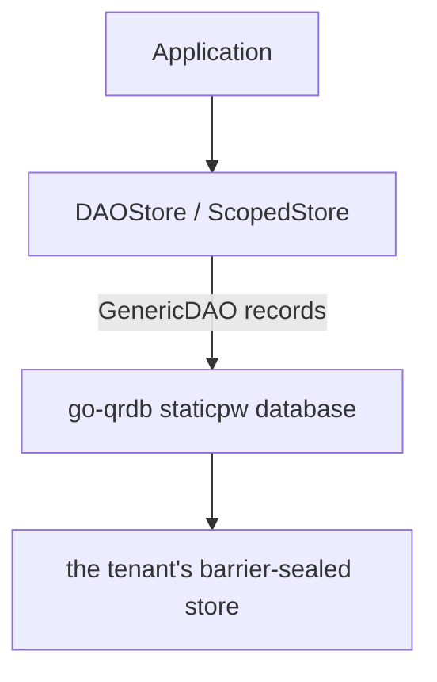
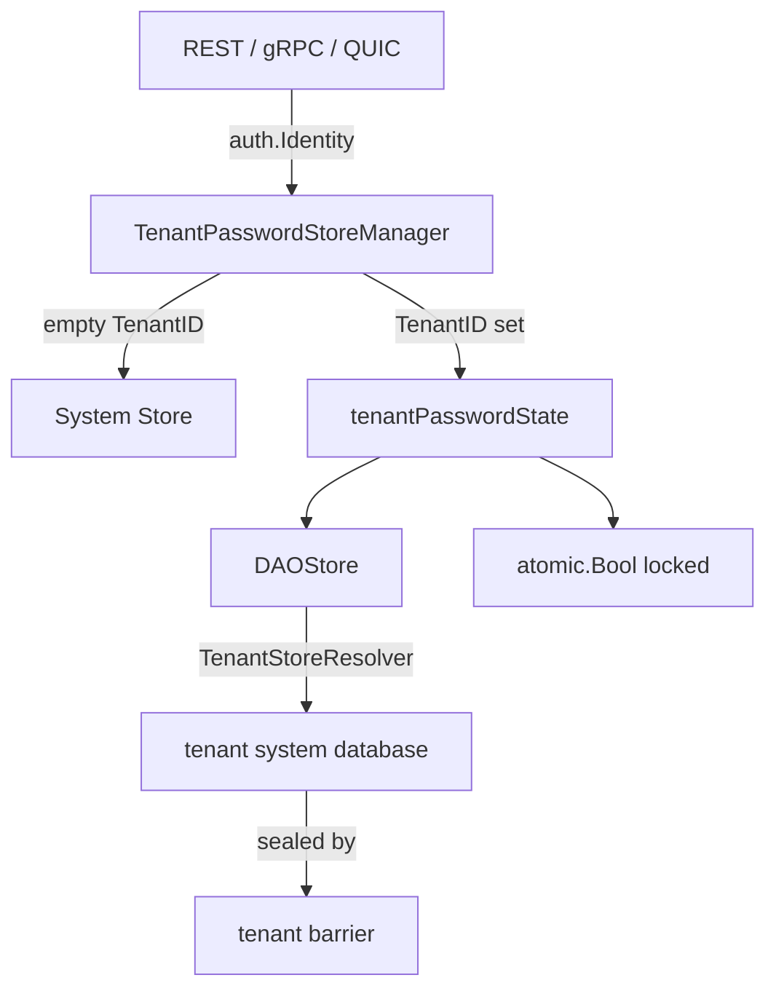

# Static Password Store

> **Superseded by [Password Vault](../password-vault/)** — see
> [architecture.md](../password-vault/architecture.md),
> [engineering.md](../password-vault/engineering.md),
> [cli.md](../password-vault/cli.md), [api.md](../password-vault/api.md), and
> [user.md](../password-vault/user.md) for the actively-maintained
> documentation of this feature. This file is retained only for detail the
> feature folder has not yet absorbed; where the two disagree, the feature
> folder wins. It was corrected (go-xkms#864) to remove `EncryptedStore`,
> `PINAccessStore`, and `SessionStore`, which no longer exist in
> `pkg/staticpw`.

## Overview

The `staticpw` package provides a password manager for static credentials (login usernames, passwords, URLs, and notes). It supports multi-tenant isolation, hierarchical folder organization, case-insensitive name lookups, and a session-based access-control mode. Encryption at rest is a property of the barrier-sealed go-qrdb store the records live in, not of `pkg/staticpw` itself (bar the personal DEK) — see "Encryption" below.

**Package**: `github.com/jeremyhahn/go-xkms/pkg/staticpw`

## Architecture



The store has one concrete implementation and no decorator chain. The
normative description is [password-vault](../password-vault/engineering.md).

1. **DAOStore** (`store.go:108`) -- core CRUD over go-qrdb `GenericDAO` records in the `staticpw` database (`records.go`), with folder operations and tenant/scope path prefixes. A personal store seals each record body with the user's DEK; at-rest encryption is otherwise the store's barrier.
2. **ScopedStore** (`scoped_store.go`) composes a shared and a personal `DAOStore` to route reads and writes by the entry's `Shared` flag.

## Data Model

```go
type StaticPassword struct {
    ID            string            // deterministic, derived from Name + FolderPath
    Name          string            // human-readable label (required)
    Title         string            // optional display title, falls back to Name
    Username      string            // optional login username
    Password      string            // the stored password (required)
    URL           string            // optional service URL
    MatchPatterns []string          // optional glob patterns for browser-extension URL matching
    Notes         string            // optional user notes
    FolderPath    string            // hierarchical folder (e.g. "Work/Email")
    ExpiresAt     time.Time         // optional expiration (zero = no expiry)
    CreatedAt     time.Time         // creation timestamp
    UpdatedAt     time.Time         // last modification timestamp
    ReadOnly      bool              // auto-generated entries that cannot be modified
    OwnerID       string            // creator, stamped automatically by ScopedStore
    Shared        bool              // tenant-wide (true) vs. personal (false, default)
    Attributes    map[string]string // caller-defined metadata, not interpreted by staticpw
}
```

(`pkg/staticpw/types.go:28`)

IDs are deterministic: `strings.ToLower(folderPath + "/" + name)` (or just `strings.ToLower(name)` for root-level entries).

## Store Interface

```go
type Store interface {
    Add(pw *StaticPassword) error
    Get(idOrName string) (*StaticPassword, error)
    List() ([]*StaticPassword, error)
    Update(pw *StaticPassword) error
    Delete(idOrName string) error
    ListByFolder(folderPath string) ([]*StaticPassword, error)
    ListFolders() ([]string, error)
    MoveToFolder(idOrName string, folderPath string) error
    Close() error
}
```

`Get` and `Delete` accept either an ID or a name. An exact key lookup is attempted first; if that fails, a case-insensitive name scan is performed.

## Multi-Tenant Support

`DAOStore` persists through the go-qrdb DAO factory its composition root injects:

```go
// The system store, on the composition root's datastore.
store, err := staticpw.NewStore(daos)

// A tenant's store, path-prefixed by the tenant ID.
store, err := staticpw.NewTenantStore(daos, "org-42")
```

Tenant IDs must be 1-64 characters, start with an alphanumeric character, and contain only alphanumeric characters, hyphens, and underscores (`ErrInvalidTenantID` otherwise). `TenantPasswordStoreManager` takes go-qrdb's `TenantStoreResolver` and opens each tenant's stores in that tenant's own system database, behind that tenant's barrier.

## Encryption

Shared entries are encrypted at rest by the barrier of the go-qrdb store they live in; `pkg/staticpw` adds no cipher of its own for them. Personal entries are additionally sealed with the owner's DEK (`records.go`). Encryption, key management, and seal/unseal state otherwise belong entirely to the barrier (owned by go-qrdb) — see [Sealing and Barrier](../sealing-and-barrier/architecture.md). `Get`/`List` return entries exactly as stored; there is no `GetDecrypted` call.

A host without a go-qrdb node (xkey) builds its DAO factory with `sdk/go.NewBackendDAOFactory` over its barrier backend, so its entries are sealed by its own barrier.

## Access Modes

`AccessMode` (`access.go:29`) names two policies, but only one is a reachable code path (`access.go:16-28`):

- **`AccessSessionBased`** (`access.go:37`) is the only mode actually implemented. `TenantPasswordStoreManager.UnlockTenant`/`LockTenant` (`tenant_store_manager.go:162`, `:143`) hold a per-tenant `atomic.Bool` session lock, gated on the tenant barrier being unsealed. The PIN itself is verified one layer up, by `XKMSService.verifyPasswordStoreUserPIN` (`pkg/xkms/servicer_password.go:361`), before `UnlockTenant` is called, so there is exactly one credential check.
- **`AccessPINPerOperation`** (`access.go:33`) is defined as a constant but has no store implementation — `pkg/staticpw` ships no per-operation PIN-gated store.

```go
manager, err := staticpw.NewTenantPasswordStoreManager(barrierRegistry, systemStore)

err = manager.UnlockTenant("org-42")   // requires the tenant barrier unsealed
store, err := manager.ResolveStore("org-42")
entries, err := store.List()           // works once unlocked

err = manager.LockTenant("org-42")     // always permitted; no credential needed
```

There is no `Unlock`/`Lock` method on `Store` or `DAOStore` themselves, and no `GetDecrypted(id, pin)` call: session state lives in `TenantPasswordStoreManager`, one level above the store.

## Folder Organization

Entries are organized into a hierarchical folder structure. Nested folders are derived automatically:

```go
// Add entries in different folders
store.Add(&staticpw.StaticPassword{
    Name: "Gmail", Password: "...", FolderPath: "Work/Email",
})
store.Add(&staticpw.StaticPassword{
    Name: "AWS Console", Password: "...", FolderPath: "Work/Cloud",
})

// List all folders (includes parent paths)
folders, _ := store.ListFolders()
// ["Work", "Work/Cloud", "Work/Email"]

// List entries in a specific folder
entries, _ := store.ListByFolder("Work/Email")

// Move an entry to a different folder (regenerates ID)
err := store.MoveToFolder("Gmail", "Personal/Email")
```

## Password Generation

The package includes a cryptographically secure password generator using `crypto/rand`:

```go
// Default: 32 characters, all character sets
pw, err := staticpw.GeneratePassword(0, "")

// Custom: 16 characters, alphanumeric only
pw, err := staticpw.GeneratePassword(16, "alphanumeric")

// Length range: 8-128 characters
```

## Expiry Checking

`ExpiryChecker` runs a background goroutine that periodically scans for and deletes expired entries:

```go
checker := staticpw.NewExpiryChecker(store, 5*time.Minute, func(pw *staticpw.StaticPassword) {
    log.Printf("expired: %s", pw.Name)
})
checker.Start()
defer checker.Stop()
```

## Error Handling

All errors are declared as typed package-level variables:

| Error | Meaning |
|-------|---------|
| `ErrPasswordNotFound` | Entry not found by ID or name |
| `ErrPasswordExists` | Duplicate entry detected |
| `ErrPasswordReadOnly` | Cannot modify auto-generated entry |
| `ErrStoreClosed` | Store has been closed |
| `ErrStoreLocked` | Session is locked (`TenantPasswordStoreManager`) |
| `ErrInvalidTenantID` | Invalid tenant identifier |
| `ErrStoreNotLocked` | `UnlockTenant` called when already unlocked |
| `ErrStoreAlreadyLocked` | `LockTenant` called when already locked |
| `ErrNilTenantStores` | Tenant store resolver is nil |
| `ErrNotConfigured` | Password store not configured |

## Personal and Shared Password Scoping

Within a tenant, passwords are separated into **personal** (per-user) and **shared** (tenant-wide) namespaces using key prefix isolation.

### Key Prefix Layout

```
# System (single-tenant, unchanged):
staticpw/{id}.json

# Tenant shared passwords:
{tenantID}/staticpw/shared/{id}.json

# Tenant personal passwords:
{tenantID}/staticpw/users/{userID}/{id}.json
```

### ScopedStore

`ScopedStore` is a composite `Store` that wraps a shared `DAOStore` and a personal `DAOStore`. It routes operations based on the password's `Shared` flag:

```go
// Create stores for a specific user within a tenant.
shared, _ := staticpw.NewSharedTenantStore(backend, "acme")
personal, _ := staticpw.NewPersonalTenantStore(backend, "acme", "alice@acme.com")
scoped, _ := staticpw.NewScopedStore(shared, personal, "alice@acme.com")

// Add a personal password (default).
scoped.Add(&staticpw.StaticPassword{Name: "My Gmail", Password: "..."})

// Add a shared password.
scoped.Add(&staticpw.StaticPassword{Name: "Team AWS", Password: "...", Shared: true})

// List all (personal + shared).
all, _ := scoped.List()

// List by scope.
personalOnly, _ := scoped.ListByScope(staticpw.ScopePersonal)
sharedOnly, _ := scoped.ListByScope(staticpw.ScopeShared)
```

### Routing Rules

| Operation | Shared=true | Shared=false (default) |
|-----------|-------------|------------------------|
| **Add** | → shared store | → personal store |
| **Get** | personal first, fallback shared | personal first, fallback shared |
| **Delete** | personal first, fallback shared | personal first, fallback shared |
| **Update** | → shared store | personal first, fallback shared |
| **List** | merged from both | merged from both |
| **ListByScope** | filter by scope | filter by scope |

### PasswordScope

```go
type PasswordScope string

const (
    ScopePersonal PasswordScope = "personal"
    ScopeShared   PasswordScope = "shared"
    ScopeAll      PasswordScope = "all"
)
```

### REST API

List with scope filter: `GET /api/v1/passwords?scope=personal`

Add a shared password:

```json
POST /api/v1/passwords
{
    "name": "Team AWS",
    "password": "s3cret",
    "shared": true
}
```

Response fields include `owner_id` and `shared` for each entry.

### Cross-User Isolation

Personal password isolation is enforced by key prefix separation at the storage layer. A user's `ScopedStore.personal` store is keyed to their userID — no cross-user access is possible without constructing a store with a different userID.

### Shared Password Ownership

Shared passwords track their creator via the `OwnerID` field, which is stamped automatically on `Add`. Modification (update/delete) of shared passwords is restricted:

| Caller | Allowed |
|--------|---------|
| Owner (`identity.Subject == pw.OwnerID`) | Yes |
| `admin` role | Yes |
| `so` role | Yes |
| Any other user | No — returns `ErrNotOwner` |

Personal passwords (`Shared=false`) skip ownership checks entirely — they are inherently scoped to the owner by key prefix isolation. Ownership enforcement is applied at the servicer layer, not the store layer.

### New Errors

| Error | Meaning |
|-------|---------|
| `ErrInvalidUserID` | User ID is empty, too long, or has invalid characters |
| `ErrNotOwner` | Non-owner tried to modify a shared password |
| `ErrInvalidScope` | Unrecognized scope value |

## Per-Tenant Password Store Manager

`TenantPasswordStoreManager` manages per-tenant password stores backed by `TenantBarrier` encryption. Each tenant gets an independent encrypted store with session-level lock state.

### Architecture



### Usage

```go
// Create manager with barrier registry and system fallback store
manager, err := staticpw.NewTenantPasswordStoreManager(barrierRegistry, systemStore)

// Resolve store based on tenant identity
store, err := manager.ResolveStore("org-42")  // tenant store
store, err := manager.ResolveStore("")         // system store

// Session lock lifecycle
err = manager.UnlockTenant("org-42")   // requires unsealed barrier
err = manager.LockTenant("org-42")

// Query status
status, err := manager.TenantStoreStatus("org-42")
// status.IsLocked, status.BarrierSealed, status.PasswordCount

// Cleanup
err = manager.Close()
```

### Session Lock vs Barrier Seal

Two independent protection layers:

| Layer | Scope | Controls | Reset |
|-------|-------|----------|-------|
| **Barrier seal** | Per-tenant DEK | Encryption/decryption of stored data | go-qrdb tenant unseal |
| **Session lock** | Per-tenant session | API-level access gating | `UnlockTenant` / `LockTenant` |

- Tenant stores start **locked** (session lock is true by default)
- `UnlockTenant` requires the barrier to be **unsealed** first
- When the barrier is sealed, all store operations fail regardless of session lock state
- `LockTenant` is always permitted (lightweight API gate)

### Unlock Credential (XKMS Servicer)

`TenantPasswordStoreManager.UnlockTenant` only checks the barrier. The service
layer (`XKMSService.PasswordStoreUnlock`) adds the credential check, so no
transport can open a tenant vault without one:

| Condition | Result |
|-----------|--------|
| Correct `user_pin` | Session unlocked |
| Wrong `user_pin` | `PINBackend.VerifyUserPIN` error, store stays locked |
| Missing `user_pin` | `ErrPasswordStoreUserPINRequired`, store stays locked |
| No PIN backend (`pin.enabled: false`) or user PIN never set | `ErrPasswordStoreUserPINNotProvisioned`, store stays locked |

The PIN is verified with `PINBackend.VerifyUserPIN`
(`pkg/xkms/servicer_password.go:361`) before `UnlockTenant` is ever called, so
there is exactly one credential path. Locking needs no credential: it only
removes access.

`XKMSService.PasswordGet` refuses `decrypt` / `user_pin`
(`ErrPasswordDecryptNotSupported`): the barrier-backed stores reachable from
the servicer return entries exactly as stored and have no field-level
decryption entry point, so the request is reported instead of silently
answered with the stored value.

### REST API Endpoints

The session and vault routes live under `/api/v1/password-vault`; the
authoritative table is [api.md](../password-vault/api.md).

### Error Mapping

| Error | HTTP Status | Meaning |
|-------|-------------|---------|
| `ErrStoreLocked` | 423 Locked | Session is locked, unlock first |
| `ErrStoreNotLocked` | 409 Conflict | Already unlocked |
| `ErrStoreAlreadyLocked` | 409 Conflict | Already locked |
| `seal.ErrTenantSealed` | 503 Service Unavailable | Barrier not unsealed |
| `seal.ErrTenantNotFound` | 404 Not Found | Unknown tenant |

### Concurrency

`TenantPasswordStoreManager` uses `sync.Map` for lock-free tenant state caching and `atomic.Bool` for session lock transitions. No mutexes are held during normal operations.

## Thread Safety

`DAOStore` serializes concurrent writers of one record with go-qrdb's guarded writes (read, compare, retry). `TenantPasswordStoreManager` uses `sync.Map` and `atomic.Bool` for lock-free session-lock and tenant-state transitions across tenants.

## See Also

- [Password Vault](../password-vault/) -- the actively-maintained feature folder that supersedes this document
- [Sealing and Barrier](../sealing-and-barrier/) -- the barrier that encrypts a `storage.Backend` at rest
- [Multi-Tenancy](../multi-tenancy/) -- tenant isolation and tenant barriers
