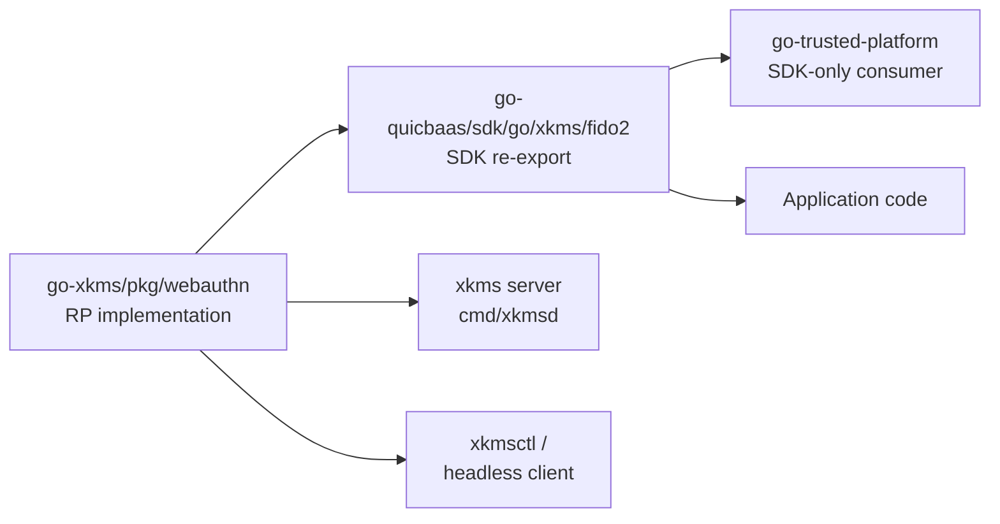

# WebAuthn / FIDO2 Relying Party

`pkg/webauthn` is the **canonical WebAuthn / FIDO2 relying party** for the
entire stack. xkms is the single home for the RP implementation; the
QuicBaaS Go SDK re-exports the surface, and go-trusted-platform consumes
the SDK re-export rather than maintaining its own copy.

## Single canonical RP



Phase 6 deleted `go-trusted-platform/pkg/fido2/` outright; the platform's
initrd path now reaches WebAuthn exclusively through
`go-quicbaas/sdk/go/xkms/fido2`, which re-exports the xkms types as pure
aliases. There is no second relying-party implementation anywhere in the
stack.

| Layer | Repository | Role |
|-------|-----------|------|
| RP service + storage interfaces | `go-xkms/pkg/webauthn` | The implementation. Owns `Service`, `Config`, `UserStore`, `CredentialStore`, `SessionStore`, and the HTTP handler set. |
| Headless client | `go-xkms/pkg/webauthn/client` | "Browser" that drives the RP from CLI / test code; ships with `SoftwareAdapter` for in-memory auth. |
| SDK re-export | `go-quicbaas/sdk/go/xkms/fido2` | Pure-alias package exposing the xkms RP surface so SDK consumers do not import `go-xkms` directly. |
| Server transport | `go-xkms/cmd/xkmsd` | Mounts the HTTP handlers under `/api/v1/webauthn/...` and integrates RP storage with the barrier. |

## RP service surface

The `Service` type (`pkg/webauthn/service.go`) is the canonical entry point.
It wraps `go-webauthn/webauthn` and adds pluggable storage and JWT
generation hooks.

```go
import "github.com/jeremyhahn/go-xkms/pkg/webauthn"

svc, err := webauthn.NewService(webauthn.ServiceParams{
    Config: &webauthn.Config{
        RPID:          "kms.example.com",
        RPDisplayName: "xKMS",
        RPOrigins:     []string{"https://kms.example.com:8443"},
    },
    UserStore:       userStore,
    SessionStore:    sessionStore,
    CredentialStore: credentialStore,
})
```

| Operation | Method | Purpose |
|-----------|--------|---------|
| Begin registration | `Service.BeginRegistration` | Returns `CreationOptions` JSON for the client/authenticator |
| Finish registration | `Service.FinishRegistration` | Validates attestation, persists credential |
| Begin login | `Service.BeginLogin` | Returns `RequestOptions` JSON, recording session |
| Finish login | `Service.FinishLogin` | Validates assertion, returns `LoginResult` (optional JWT) |
| Bulk import | `Service.ImportCredentials` | One-shot migration entry point used by the Phase 6e migration script |

The storage interfaces (`UserStore`, `CredentialStore`, `SessionStore`) are
defined in `pkg/webauthn/interfaces.go` and have in-memory implementations
in `memory_stores.go` for development; production wiring goes through
`qrdb_userstore.go`, which composes the qrdb user store into the WebAuthn
contract.

## HTTP handlers (`pkg/webauthn/http`)

The HTTP layer is the composable bridge between the RP service and any
mux. `xkmsd` mounts these handlers; the SDK re-export does not, because
SDK consumers handle their own routing.

```go
import webauthnhttp "github.com/jeremyhahn/go-xkms/pkg/webauthn/http"

handler := webauthnhttp.NewHandler(svc)
webauthnhttp.MountChi(r, handler)  // chi router
webauthnhttp.MountMux(r, handler)  // gorilla/mux
```

## SDK re-export contract

`go-quicbaas/sdk/go/xkms/fido2` exposes the RP types as pure aliases — no
shims, no transports, no client wrappers. The same `webauthn.Service` value
constructed by the xkms server is the value an SDK consumer instantiates;
the alias only changes the import path.

| Consumer | How it talks to the RP |
|----------|------------------------|
| `cmd/xkmsd` | Direct: imports `pkg/webauthn`, mounts the HTTP handlers |
| `cmd/xkmsctl` headless client | Direct via `pkg/webauthn/client` |
| go-trusted-platform initrd | SDK re-export only (`quicbaas/sdk/go/xkms/fido2`) |
| Third-party Go applications | SDK re-export only |

## See also

- [Headless WebAuthn Client](client.md) — the "browser" implementation used
  by `xkmsctl` and integration tests.
- [Bootstrap Authentication](../auth/bootstrap.md) — how FIDO2 attestation
  is bound to the first admin during first-boot.
- [QuicBaaS SDK — `fido2` re-export](https://github.com/jeremyhahn/go-quicbaas/tree/master/sdk/go/xkms/fido2)
