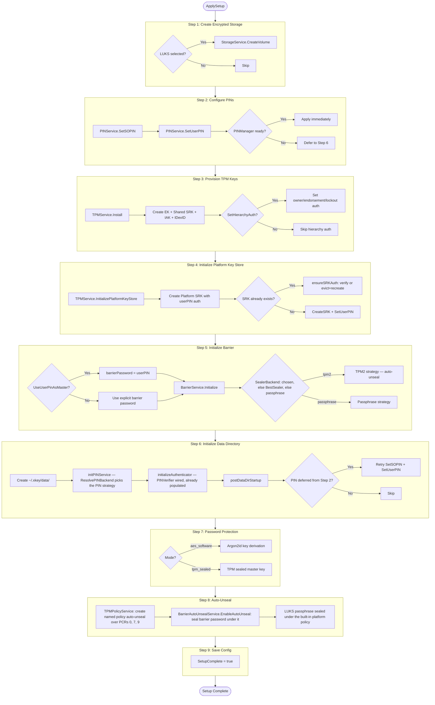
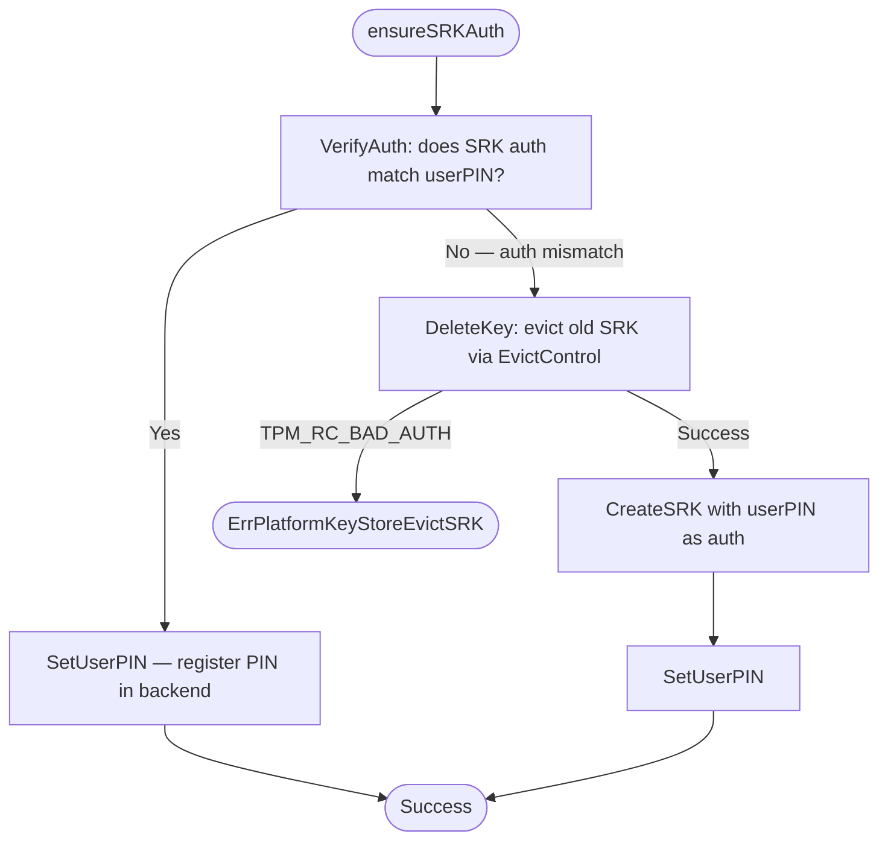
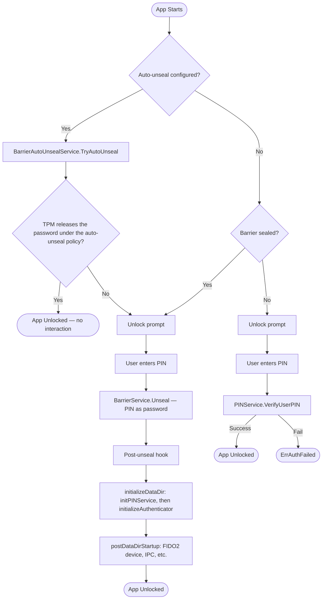
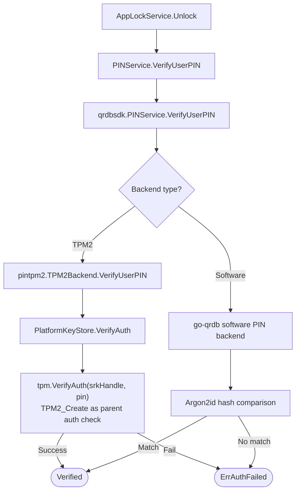
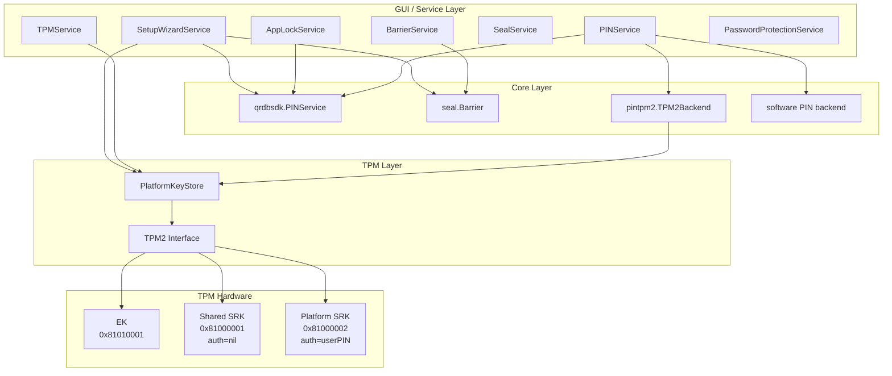

<!-- Copyright (c) 2025 Jeremy Hahn -->
<!-- Copyright (c) 2025 Automate The Things, LLC -->

# Setup Wizard and Unlock Flow

> **Status: REFERENCE** · Last verified: 2026-10-13
> Backend sequence of setup, startup unlock and app lock; the [setup-wizard](../setup-wizard/) feature folder is normative for setup.

This document describes the backend execution flow of the setup wizard, the returning user startup/unlock process, and the component architecture that ties them together.

## Setup Wizard Backend Execution (ApplySetup)

The `SetupWizardService.ApplySetup()` method executes 9 sequential steps (`setupTotalSteps`, `xkey/pkg/gui/services/setup_wizard_service.go:464`). Each step delegates to a dedicated service. Failures in non-critical steps are recorded as warnings; critical failures abort the wizard.

### Step 4 Detail: Platform SRK Provisioning

The Platform SRK (at handle `0x81000002`) is the sole key used for PIN verification. The `ensureSRKAuth` method (`pkg/tpm2/platform_keystore.go:345`) handles the case where the SRK already exists from a prior installation:

If eviction fails because the TPM owner hierarchy has auth from a prior installation, `Initialize` returns `ErrPlatformKeyStoreEvictSRK` (`platform_keystore.go:77`) with a message directing the user to clear the TPM or provide the correct SO PIN. There is no fallback to the Shared SRK — the Platform SRK is the only key used for PIN management.

## Returning User Startup Flow

`initPINService` always runs inside `initializeDataDir`, immediately before
`initializeAuthenticator` — the authenticator publishes the `PINService` as
its `PINVerifier` the moment it is constructed, so the PIN backend must
already be populated by then, or a correct PIN presented to the FIDO2
authenticator during that window would be rejected (go-xkms#640).

The right-hand branch — barrier already unsealed, so verify through
`PINService` — is reached only by an installation that has no barrier at all.
An installation with a barrier is always sealed when the app is locked,
because locking seals it. See [App Lock and Inactivity](#app-lock-and-inactivity).

## App Lock and Inactivity

`AppLockService.Lock` seals the barrier, and every route into the lock goes
through it: the inactivity timer, the lock button, and the OS screen-lock
signal. A lock that only blanked the interface would leave the barrier's data
encryption key resident in the process, so it protected nothing against
anything with access to the machine.

Sealing on lock also settles which credential the lock screen checks. The
screen prompts for one secret and sends one value, while `Unlock` chooses its
verifier from the barrier's seal state: the barrier credential while the
barrier is sealed, the PIN service's credential once it is not. Those are two
independent credential stores whose values nothing binds together — a
`passphrase` barrier alongside a `tpm2` PIN strategy is two different secrets
— so a lock that left the barrier open sent the unlock to a verifier the user
was never prompted for. With the barrier sealed on every lock, each unlock
takes the same route the startup unlock takes.

This matters beyond the failed unlock. The `tpm2` PIN backend verifies against
the PlatformSRK's auth value, and every failed attempt spends one of the TPM's
dictionary-attack retries — three on typical hardware, after which the TPM
enters a lockout that blocks all SRK-auth operations until the recovery
interval elapses or `TPM2_DictionaryAttackLockReset` is run.

The app is locked whether or not the barrier could be sealed: refusing to lock
because the key could not be zeroed would leave the interface open, which is
worse. A seal failure is reported as `ErrAppLockBarrierSealFailed` rather than
being swallowed, so a lock weaker than it claims to be is visible.

Unlocking after an in-process lock reopens the existing barrier rather than
building a replacement. The post-unseal hook wires every barrier-backed store
once per process and hands each one a backend wrapping the live barrier; a
replacement would leave all of them bound to the sealed object with no route
back, so the app would unlock while every encrypted store stayed unreadable
until restart.

### PIN Verification Chain

## Component Architecture

### TPM Handle Assignments

| Handle | Name | Auth | Purpose |
|--------|------|------|---------|
| `0x81010001` | Endorsement Key (EK) | Hierarchy-controlled | Platform identity, credential activation |
| `0x81000001` | Shared SRK (SSRK) | nil (empty) | TCG-standard parent for sealed objects (barrier, seal service) |
| `0x81000002` | Platform SRK | userPIN | PIN verification via password auth |

The Shared SRK is provisioned during `TPMService.Install()` and is used **only** as a parent key for sealed objects created by the barrier and seal services. The Platform SRK is provisioned during `TPMService.InitializePlatformKeyStore()` and is the sole key used for PIN verification. These two keys serve distinct purposes and must not be conflated.
